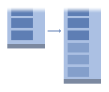

****

**1 无穷滚动（无限加载）与分页的比较**

现在越来越多的网站或者博客的列表页开始抛弃传统的分页技术，大致的原因在于，分页明显地增加了用户的操作行为以及页面加载等待的时间，而网页浏览者往往没什么耐心。

而无穷滚动提供给了读者一种沉浸式的阅读体验。新版的[Yahoo.com](https://www.yahoo.com/)亦开始拥抱这一技术。

**2 无穷滚动的实现原理**

(1) 设置存在内容的一个容器“container”，这个容器就放着内容列表；

(2) 设置计时器或者$(window).scroll()事件，计算**容器“container”的高度** 与 **$(window).height()和$(window).scrollTop()之和** 的大小关系；

(3) 当前者小于后者时，通过**ajax**，将新内容**append**到容器“container”。

**3 核心代码演示**

```
$(document).ready(function () {
            var container = $('容器'); // 获取容器
            var i = 0; // 分页值，用于select记录时给limit赋值
            $(window).scroll(function () {
                var containerHeight = container.height() + 121; // 容器高度 + 容器top至文档top的距离　　　　　　　　   var distance = $(window).height() + $(window).scrollTop(); // 视口高度 + 滚动距离
                if (containerHeight <= distance) {
                    $.ajax({
                        type: 'post',
                        url: "控制器/方法",
                        data: {i: i},
                        success: function (data) {
                            i++; // 分页值+1
                            $.each(data, function (i, n) {
                             　　　// 数据处理代码
                                container.append('新内容'); // append新内容
                            });
                        }
                    });
                }
            });
        });
```

4 生产环境代码推荐

当然，上述代码只是阐述了无穷滚动的实现原理，生产环境推荐[infinite-scroll](https://github.com/infinite-scroll/infinite-scroll)
