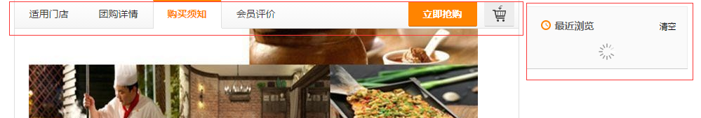

**1.什么是悬停**

当推荐位DIV自出现在视野中后，始终悬浮停留在相对浏览器固定的某一位置，使该推荐位里的内容一直在视野中。

**2 实例**

<http://t.dianping.com/deal/10752942>



**3 jQuery代码**

```
$(document).ready(function(){
    var target = $('你想悬停的div');
    var positionTop = target.position().top; // 计算target距离文档原点的高度，所以target的父元素最好没有potision属性
    var positionLeft = target.position().left;
    $(window).scroll(function(){
        var scrollTop = $(window).scrollTop();
        if (scrollTop >= positionTop)
        {
            target.css({position:'fixed',left:positionLeft,top:0}); // 当滚动距离大于positionTop时，将target的position改为fixed
        }
        else
        {
　　　　　　　target.css({position:'static',left:positionLeft,top:positionTop}); // 当滚动距离小于postioinTop时，将target的position改为static
        }
    });
}); 
```

**4 总结**

上述代码只是我逆向反推的，我暂时也没找到国外优秀的类似jQuery插件。欢迎大家推荐类似的插件给大家。
