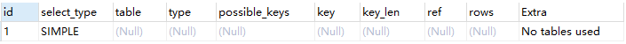
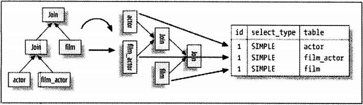

Explain命令是查看查询优化器如何决定执行查询的主要办法。

**调用 EXPLAIN**

要使用EXPLAIN，只需在查询中的SELECT关键字之前增加EXPLAIN。MySQL会在查询上设置一个标记。当执行查询时，这个标记会使其返回关于在执行计划中每一步的信息，而不是执行它（一般情况下）。它会返回一行或多行信息，显示出执行计划中的每一部分和执行的次序。

explain select 1结果示例：

在查询中每个表在输出中只有一行。如果查询是两个表的连接，那么输出中将有两行。别名表单算为一个表。如果把一个表与自己来凝结，输出中也会有两行。"表"意义在这里相当广泛：可以是一个子查询，一个UNION结果等。

EXPLAIN 有两个主要变种：

- EXPLAIN EXTENDED。它会通知服务器"逆向编译"执行计划为一个SELECT语句。可以通过紧接其后运行SHOW WARNINGS看到这个生成的语句。这个语句直接来自执行计划，而不是原SQL语句，到这点上已经变成一个数据结构。在大部分场景下它都与原语句不相同。（结果输出添加了filterd列）

- EXPLAIN PARTITIONS。它会显示查询将访问的分区，如果查询是基于分区表的话。 （结果输出添加了partitions列）

认为增加EXPLAIN时，MySQL不会执行查询，这是一个常见错误。如果查询在FROM子句中包括子查询，那么MySQL实际上会执行子查询，将其结果放在一个临时表中，然后完成外层查询优化。它必须在可以完成外层查询优化之前处理所有类似的子查询。

EXPLAIN只是一个近似结果。以下有一些相关的限制：

- EXPLAIN不会告诉你触发器、存储过程或UDF会如何影响查询。
- EXPLAIN 不支持存储过程，尽管可以手动抽取查询并单独对其进行EXPLAIN操作。
- EXPLAIN不会告诉你MySQL在查询执行中所做的特定优化。
- EXPLAIN不会显示关于查询的执行计划的所有信息。
- EXPLAIN不区分具有相同名字的事物。例如，它对内存排序和临时文件都使用"filesort"，并且对于磁盘上和内存中的临时表都显示"Using temporary"。

**EXPLAIN 中的列**

explain的输出的列包括：id、select\_type、table、type、possible\_keys、key、key\_len、ref、rows、Extra等。

**id 列**

这一列总是包含一个编号，标识select所属的行。如果在语句当中没有子查询或联合，那么只会有唯一的select，于是每一行在这个列种都将显示一个1。否则，内层的select语句一般会顺序编号，对应于其在原始语句中的位置。

MySQL将SELECT查询分为简单和复杂类型，复杂类型可分为三大类：简单子查询、所谓的派生表（在FROM子句中的子查询），以及UNION查询。

注意UNION结果输出中的额外行。UNION结果总是放在一个匿名临时表中，之后MySQL将结果读取到临时表外。临时表并不在原SQL中出现，因此它的id列是NULL。

**select\_type 列**

这一列显示了对应行是简单还是复杂select。值如下：

|  |  |
| --- | --- |
| SIMPLE | 该查询不包括子查询和UNION。 |
| PRIMARY | 复杂SELECT的最外层行。 |
| SUBQUERY | 包含在SELECT 列表中的子查询中的select（简单子查询）。    SUBQUERY还可被标记为DEPENDENT，DEPENDENT SUBQUERY 意味着SELECT依赖于外层查询中发现的数据。 |
| DERIVED | 包含在FROM子句的子查询中的SELECT 。    MySQL会递归执行并将结果放到一个临时表中。服务器内部称其"派生表"，因为该临时表是从子查询中派生出来的。 |
| UNION | 在UNION中的第二个和随后的SELECT 。    第一个SELECT被标记就好像它以部分外查询来执行。如果UNION被FROM子句中的子查询包含，那么它的第一个SELECT会被标记为DERIVED 。    UNION还可被标记为UNCACHEABLE。UNCACHEABLE UNION 意味着SELECT中的某些特性阻止结果被缓存与一个Item\_cache中。 |
| UNION RESULT | 用来从UNION的匿名临时表检索结果的SELECT。 |

**table 列**

这一列显示对应行正在访问哪个表。可以在这一列中从上往下观察MySQL的关联优化器为查询选择的关联顺序。

查询执行计划于EXPLAIN中的行相对应的方式：

**派生表和联合**

当FROM子句中有子查询或有UNION时，table列会变得复杂得多。在这些场景下，确实没有一个"表"可以参考到，因为MySQL创建的匿名临时表仅在查询执行过程中存在。

当在FROM子句中有子查询时，table列是<derivedN>的形式，其中N是子查询的id。这总是"向前引用"。换言之，N指向EXPLAIN输出中后面的一行。

当有UNION时，UNION RESULT的table列包含一个参与UNION的id列表。这总是"向后引用"，因为UNION RESULT出现在UNION中所有参与行之后。

**type 列**

type列显示MySQL的访问类型，即MySQL决定如何查找表中的行。下面是重要的访问方法，依次从最差到最优：

|  |  |
| --- | --- |
| ALL | 全表扫描，通常意味着MySQL必须扫描整张表，从头到尾，去找到需要的行。    这里也有个例外，例如在查询里使用了LIMIT，或者在Extra列中显示"Using distinct/not exists"。 |
| index | 这个跟全表扫描一样，只是MySQL扫描表是按索引次序进行而不是行。它的主要优点是避免了排序；最大的缺点是要承担按索引次序读取整个表的开销。这通常意味着若是按随机次序访问行，开销将会非常大。    如果在Extra列种看到"Using index"，说明MySQL正在使用覆盖索引，它只扫描索引的数据，而不是按索引次序的每一行。它比按索引次序全表扫描的开销要少很多。 |
| range | 范围扫描时一个有限制的索引扫描，它开始于索引里的某一点，返回匹配这个值域的行。    这比全索引扫描好一些，因为它用不着遍历全部索引。显而易见的范围扫描是带有BETWEEN或在WHERE子句里带有>的查询。    当MySQL使用索引去查找一系列值时，例如IN()和OR列表，也会显示为范围扫描。然而，这两者其实是相当不同的访问类型，在性能上有主要的差异。    此类扫描的开销跟索引类型相当。 |
| ref | 这是一种索引访问（有时也叫做索引查找），它返回所有匹配某个单个值得行。然而，它可能会找到多个符合条件的行，因此，它是查找和扫描的混合体。此类索引访问只有当使用非唯一性索引或者唯一性索引的非唯一性前缀才会发生。把它叫做ref是因为索引要跟某个参考值相比较。这个参考值或者是一个常数，或者是来自多表查询前一个表里的结果值。    ref\_or\_null是ref之上的一个变体，它意味着MySQL必须在初次查找的结果。 |
| eq\_ref | 使用这种索引查找，MySQL知道最多只返回一条符合条件的记录。    这种访问方法可以在MySQL使用主键或者唯一性索引查找时看到，它会将他们与某个参考值作比较。MySQL对于这类访问类型的优化坐的非常好，因为它知道无需估计匹配行的范围或在找到匹配行后再继续查找。 |
| const, system | 当MySQL能对查询的某部分进行优化并将其转换成一个常量时，它就会使用这些访问类型。    例如，如果你通过将某一行的主键放入where子句里的方式来选取此行的主键，MySQL就能把这个查询转换为一个常量。然后就可以高效地将表从联接执行中移除。 |
| NULL | 这种访问方式意味着MySQL能在优化阶段分解查询语句，在执行阶段甚至用不着再访问表或者索引。    例如，从一个索引列里选取最小值可以通过单独查找索引来完成，不需要执行时访问表。 |

**possible\_key 列**

这一列显示了查询可以使用哪些索引，这是基于查询访问的列和使用的比较操作符来判断的。这个列表是在优化过程的早期创建的，因此有些罗列出来的索引可能对于后续优化过程是没用的。

**key 列**

这一列显示了MySQL决定采用哪个索引来优化对该表的访问。如果该索引没有出现在possible\_key列中，那么MySQL选用它是处于另外的原因。例如，它可能选择了一个覆盖索引，哪怕没有WHERE子句。

possible\_key揭示了哪一个索引能有助于高效地行查找，而key显示的是优化采用哪一个索引可以最小化查找成本。

**key\_len 列**

这列显示了MySQL在索引里使用的字节数。如果MySQL正在使用的只是索引里的某些列，那么就可以这这个值来算出具体是哪些列。

key\_len 列显示了在索引字段中可能的最大长度，而不是表中数据使用的实际字节数。

**ref 列**

这一列显示了之前的表在key列记录的索引中查找值所用的列或常量。

**rows 列**

这一列是MySQL估计为了找到所需的行而要读取的行数。这个数据是内嵌循环关联计划里的循环数目。也就是说它不是MySQL认为它最终要从表里读取出来的行数，而是MySQL为了找到符合查询的每一点上标准的那些行而必须读取的行的平均数。（这个标准包括SQL里给定的条件，以及来自联接次序上前一个表的当前列）。

这个数字是MySQL认为它要检查的行数，而不是结果集里的行数。

**Extra 列**

这一列包含的是不适合在其他列显示的额外信息。常见的最重要的值如下：

|  |  |
| --- | --- |
| Using index | 此值表示MySQL将使用覆盖索引，以避免访问表。不要把覆盖索引和index访问类型混淆。 |
| Using where | 这意味着MySQL服务器将在存储引擎检索行后再进行过滤。许多where条件里涉及索引中的列，当（并且如果）它读取索引时，就能被存储引擎检验，因此不是所有带where子句的查询都会显示"Using where"。有时"Using where"的出现就是一个暗示：查询可受益于不同的索引。 |
| Using temporary | 这意味着MySQL在对查询结果排序时会使用一个临时表。 |
| Using filesort | 这意味着MySQL会对结果使用一个外部索引排序，而不是按索引次序从表里读取行。MySQL有两种文件排序算法。两种方式都可以在内存或磁盘上完成。但EXPLAIN无法知晓MySQL将使用哪一种文件排序，也不会告诉你排序会在内存里还是磁盘上完成。 |
| Range checked for each record(index map: N) | 这个值意味着没有好用的索引，新的索引将在联接的每一行上重新估算。N是显示在possible\_keys列种索引的位图，并且是冗余的。 |

**filtered 列**

这一列在使用EXPLAIN EXTENDED时出现。它显示的是针对表里符合某个条件（where子句或联接条件）的记录数的百分比所做的一个悲观估算。如果将rows列和这个百分比相乘，就能看到MySQL估算它将和查询计划里前一个表关联的行数。
