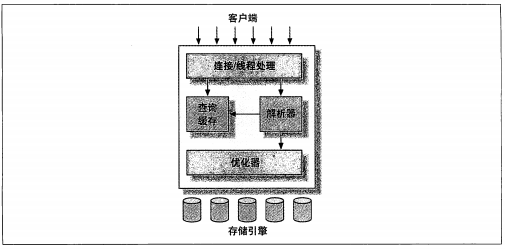

MySQL 最重要、最与众不同的特性是他的存储引擎架构，这种架构的设计将查询处理（Query Precessing）及其系统任务（Server Task）和数据的存储/提取相分离。

**1.1 MySQL 逻辑架构**

**基础服务层**

第一层构架 ：包含连接处理、授权认证、安全等基础服务功能；

**核心服务层**

第二层构架 ：包含查询解析、分析、优化（包括重写查询、决定表的读取顺序、选择合适的索引等）、缓存以及内置函数，所有跨存储引擎的功能也在这一层实现：存储过程、触发器、视图等；

**存储引擎层**

第三层构架 ：响应上层服务器请求，负责数据的存储和提取；

**1.2 并发控制**

**读写锁**

MySQL通过由两种类型的锁组成的锁系统来解决并发控制问题。

这两类锁被称为共享锁（shared lock）和排他锁（exclusive lock）；

**锁粒度**

MySQL的锁粒度包括表锁和行级锁。锁策略就是在锁的开销和数据的安全性（并发处理的支持性）之间寻求平衡，这种平衡当然也会影响到性能；

**表锁（table lock）**

锁定整张表（MyISAM型表 或 进行 ALTER TABLE 操作）。

**行级锁（row lock）**

行级锁可最大程度地支持并发处理（同时也带来了最大的锁开销），行级锁只在存储引擎层实现，而MySQL服务器层没有实现，服务器层完全不了解存储引擎中的锁实现。

**1.3 事务**

事务就是一组原子性的SQL查询，或者说是一个独立的工作单元。

事务内的语句，要么全部执行成功，要不全部执行失败。

**ACID 特性**

**原子性（atomicity）**

一个事务必须被视为一个不可分割的最小工作单元，整个事务中的所有操作要么全部提交成功，要么全部失败回滚，对于一个事务来说，不可能只执行其中的一部分操作，这就是事务的原子性。

**一致性（consistency）**

数据库总是从一个一致性的状态转换到另外一个一致性的状态，事务在提交前，在事务内所做的任何修改都不会保存到数据库中。

**隔离性（isolation）**

一个事务所做的修改在最终提交前，对其他事务时不可见的。

**持久性（durability）**

事务一旦提交，则其所做的任何修改都会永久保存在数据库中。

**隔离级别（****TRANSACTION ISOLATION LEVEL****）**

在SQL标准中定义了四种隔离级别，每一种级别都规定了一个事务中所做的修改，哪些在事务内和事务间可见的，哪些是不可见的。较低级别的隔离通常可以执行更高的并发，系统的开销也更低。

**未提交读（READ UNCOMMITTED）**

事务中的修改，即使没有提交，对其他事务也都是可见的；

存在脏读（Dirty Read）问题；

**提交读（READ COMMITTED）**

一个事务从开始直到提交之前，所做的任务修改对其他事务都是不可见的；

**可重复读 （REPEATABLE READ）**

MySQL默认的隔离级别；

该级别保证了在同一个事物中多次读取同样记录的结果是一致的；

但这会可能会出现幻读（Phantom Read）问题，幻读是指当某个事务在读取某个范围内的记录时，另外一个事务又在该范围内插入了新的纪录，当之前的事务再次读取该范围记录时，会产生幻行（Phantom Row）；

InnoDB通过多版本并发控制（MVCC，Multiversion Concurrency Control）来解决幻读问题；

**可串行化（SERIALIZABLE）**

最高的隔离级别，它通过强制事务串行执行，避免出现幻读问题；

SERIALIZABLE 会在读取的每一行数据上加锁（即：所有无格式 SELECT 语句被 隐式转换成 SELECT ... LOCK IN SHARE MODE），可能会导致超时和锁争用的问题；

**四种隔离级别的比较**

|  |  |  |  |  |
| --- | --- | --- | --- | --- |
| 隔离级别 | 脏读可能性 | 不可重复可能性 | 幻读可能性 | 加锁读 |
| READ UNCOMMITTED | YES | YES | YES | NO |
| READ COMMITTED | NO | YES | YES | NO |
| REPEATABLE READ | NO | NO | YES | NO |
| SERIALIZABLE | NO | NO | NO | YES |

**死锁**

死锁是指两个或者多个事务在同一资源上相互占用，并请求锁定对方占用的资源，从而导致恶性循环的现象。当多个事务试图以不同的顺序锁定资源时，就可能会产生死锁。锁哥事务同时锁定同一个资源时，也会产生死锁。

InnoDB 处理死锁的方法是将持有最少行级排他锁的事务进行回滚。

**事务日志**

事务日志可以帮助提高事务的效率。使用事务日志，存储引擎在修改表的数据时只需要修改其内存拷贝（buffer poor，即读取到内存中的数据块），再把该修改行为记录到持久（异步刷新）在硬盘上事务日志（redo log日志文件）中，而不用每次都将修改的数据本身持久到磁盘。

事务日志采用的是追加的方式，因此写日志的操作是磁盘上一小块区域内的顺序I/O，而不像随机I/O需要在磁盘的多个地方移动磁头，所以采用事务日志的方式相对来说要快得多。

事务日志持久之后，内存中被修改的数据在后台可以慢慢地刷回到磁盘。目前大多数存储引擎都是这样实现的，我们通常称之为预写式日志（Write-Ahead Logging），修改数据需要写两次磁盘。

如果数据的修改已经记录到事务日志并持久化，但数据本身还没有写回磁盘，此时系统崩溃，存储引擎在重启时能够自动恢复这部分修改的数据。

**MySQL 中的事务**

MySQL 默认采用自动提交（autocommit）模式。如果不是显式地开始一个事务（begin or start transaction），则每个查询都被当作一个事务执行提交操作，在当前连接（session，全局则为global）中，可以通过设置autocommit变量来启动或禁用自动提交模式。

show variables like '%autocommit%';

set autocommit = 0;

非事务型表，没有commit或者rollback的概念，对其记录的变更无法撤销。

alter table 等数据定义语言（DDL）或lock tables 在执行之前会强制执行 commit 提交当前的活动事务。

MySQL 通过执行 set transaction isolation level repeatable read 命令来设置隔离级别。

**隐式和显式锁定**

InnoDB 采用的是两阶段锁定协议（two-phase locking protocol）。在事务执行过程中，随时都可执行锁定。锁只有在执行 commit 或 rollback 时才会释放，悲情所有的锁是在同一时刻被释放。InnoDB会根据隔离级别在需要时自动加锁。此为隐式锁定；

InnoDB 也支持通过特定语句进行显式锁定：

select ... lock in share mode (shared lock)

select ... for update (exclusive lock)

另外 MySQL在服务器层也支持lock tables 和 unlock tables 语句，这和存储引擎无关。

**1.4 多版本并发控制（MVCC）**

**实现方式**

MySQL 的事务型存储引擎实现的不是简单的行级锁。基于提升并发性能的考虑，加入了（MVCC，Multiversion Concurrency Control，多版本并发控制）的逻辑。

MVCC 可被理解行级锁的变种，在很多情况下避免了加锁操作带来的开销。

MVCC是通过保存数据在某个时间的快照来实现的。不管需要执行多长时间，每个事务看到的数据都是一致的。

InnoDB 的MVCC 是通过每行记录后面保存两个隐藏的列来实现的。这两个列，一个保存了行的创建时间，一个保存行的过期时间（或删除时间）。当然存储的并不是实际的时间值，而是系统版本号（sestem version number），每开始一个新的事务，系统版本号都会自动递增。事务开始时刻的系统版本号作为事务的的版本号，用来和查询到的每行记录的版本号进行比较。

**select**

InnoDB 会根据以下两个条件检查每行记录：

- InnoDB 只查找版本遭遇当前事务版本的数据行（也就是，行的系统版本号小于或等于事务的系统版本号），这样可以确保事务读取的行，要么是在事务开始前已经存在的，要么是事务自身插入或者修改过的。

- 行的删除版本要么未定义，要么大于当前事务版本号。这可以确保事务读取到的行，在事务开始之前未被删除。

**insert**

InnoDB 为新插入的每一行保存当前系统版本号作为行版本号。

**delete**

InnoDB 为删除的每一行保存当前系统版本号作为行删除标识。

**update**

InnoDB 为插入一行记录，保存当前系统版本号作为行版本号，同时保存当前系统版本号到原来的行作为行删除标识。

**1.5 MySQL 的存储引擎**

**InnoDB**

InnoDB 的数据存储在表空间（tablspace）中。表空间是由 InnoDB 管理的一个黑盒子，由一系列的数据文件组成。

InnoDB 采用 MVCC 来支持高并发，并且实现了四个标准的隔离级别。其默认级别是 REPEATABLE  READ（可重复读），并且通过间隙锁（next-key locking）策略防止幻读的出现。间隙锁使得 InnoDB 不仅仅锁定查询涉及的行，还会对索引中的间隙进行锁定，以防止幻影行的插入。

InnoDB 表是基于聚簇索引表建立的。聚簇索引对主键查询有很高的性能。

InnoDB 表的二级索引（secondary index，非主键索引）中必须包含主键列。

InnoDB 支持热备份：MySQL Exterprise Backup XtraBackup。

**转换表的引擎**

ALTER TABLE table\_name ENGINE = INNODB;
