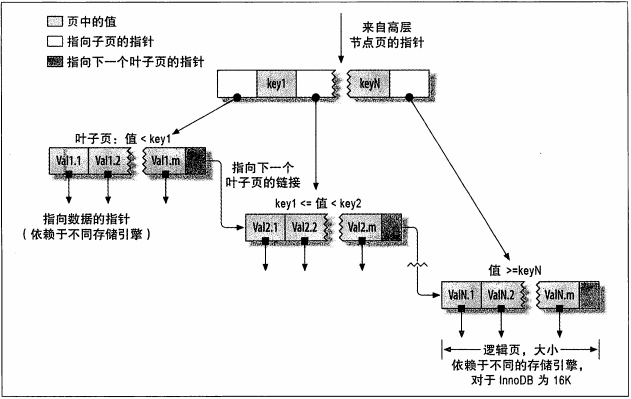
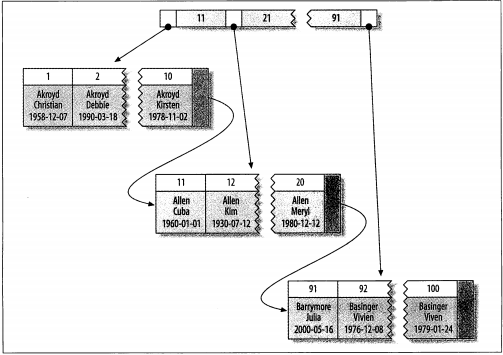

索引（index），在MySQL中也被叫做键（key），是存储引擎用于快速找到记录的一种数据结构。索引优化是对查询性能优化最有效的手段。

**5.1 索引基础**

**索引的类型**

索引是在存储引擎层而不是服务器层实现的。所以，并没有统一的索引标准；

**B-Tree 索引**

不同的存储引擎以不同的方式使用B-Tree索引，性能也各有不同；例如，MyISAM使用前缀压缩技术使得索引更小，而InnoDB则按照原数据格式进行存储。再如MyISAM索引通过数据的物理位置引用被索引的行，而InooDB则根据主键索引被索引的行。

B-Tree索引适用于全键值、键值范围或键前缀查找（即 =、>=、 <=、 >、 <、 !=、 和 like ' keyword%'）。因为索引树中的节点是有序的，所以除了按值查找之外，索引还可以用于查询中的order by和group by操作。

**索引有效的类型**

- 全值匹配：是指和索引中的所有列进行匹配。

- 匹配最左前缀：即只使用索引的第一列。

- 匹配列前缀：即只使用索引第一列的开头部分。

- 匹配范围值：只使用了索引的第一列。

- 精确匹配某个列并范围匹配另外一列：即索引第一列全匹配，第二列范围匹配。

- 只访问索引的查询：又被称为“覆盖索引”，B-tree通常支持“只访问索引的查询”，即查询只需要访问索引，而无须访问数据行。如用户名与密码的匹配，手机号与验证码的匹配。

**索引无效的类型**

- 如果不是按照索引的最左列开始查找，则无法使用索引。

- 不能跳过索引中的列。

- 如果查询中有某个列的范围查询，则其右边所有列都无法使用索引。

综上所述，能否有效使用索引的关键在于索引列的顺序。在优化性能的时候，可能需要使用相同的列但顺序不同的索引来满足不同类型的查询需求。

**5.2 索引的优点**

**优势**

- 索引大大减少了服务器需要扫描的数据量；

- 索引可以帮助服务器避免排序和临时表；

- 索引可以将随机I/O变为顺序I/O；

**评价索引是否合适的“三星系统”（three-star system）**

- 索引相关记录放在一起则获得一星；

- 索引中的数据顺序和查找中的排序顺序一致则获得二星；

- 索引中的列包含了查询中需要的全部列则获取三星；

**5.3 高性能的索引策略**

**独立的列**

如果查询中的列不是独立的，则MySQL就不会使用索引，所谓独立的列，是指索引列不能是表达式的一部分，也不能使函数的参数。

**前缀索引和索引选择性**

索引的选择性是指，不重复的索引值（也称为基数，cardinality）和数据表的记录的总数（#T）的比值，范围从1/#T到1之间。索引的选择性越高则查询效率越高，因为选择性高的所以可以让MySQL在查找时过滤掉更多的行。唯一索引的选择性是1，这是最好的索引选择性，性能也是最好的。

对于较长的VARCHAR类型的列如果必须添加索引，则必须使用前缀索引，因为MySQL不允许索引这些列的完整长度。取舍在于要选择足够长的前缀以保证较高的选择性，同时又不能太长，以便节约空间（即在索引选择性与索引空间之间做平衡）。

前缀索引是一种能使索引更小、更快的有效方法，但另一方面也有其缺点：MySQL无法使用前缀索引做order by 和 group by，也无法使用前缀索引做覆盖扫描。

**前缀索引的长度的判断方法**

SELECT

count(DISTINCT LEFT(field\_name, 3)) / count(\*) AS sel3,

count(DISTINCT LEFT(field\_name, 4)) / count(\*) AS sel4,

count(DISTINCT LEFT(field\_name, 5)) / count(\*) AS sel5,

count(DISTINCT LEFT(field\_name, 6)) / count(\*) AS sel6,

count(DISTINCT LEFT(field\_name, 7)) / count(\*) AS sel7,

FROM

table\_name

**添加前缀索引**

ALTER TABLE table\_name ADD KEY (field\_name, num);

**多列索引**

为每个列创建独立的索引或者按照错误的顺序创建多列索引，是常见的错误索引策略。应该集中精力优化索引列的顺序，或者创建一个全覆盖的索引。

在多个列上建立独立的单列索引大部分情况下并不能提高MySQL的查询性能。MySQL的“索引合并”（index merge）策略一定程序上可以使用表上的多个单列索引来定位指定的行。索引合并策略能够同时使用多个单列索引进行扫描，并将结果进行合并。具体可查看explain中的extra列。

虽然索引合并策略有时候是一种优化的结果，但从另一角度也说明索引建得很糟糕（即如果在explain中看到有索引合并，则应该检查一下查询和表的结构）。

- 当出现服务器对多个索引做相交操作时（通常有多个and条件），通常意味着需要一个包含所有香港列的多列索引，而不是多个独立的单列索引。

- 当服务器需要对多个索引做联合操作时（通常有多个or条件），通常需要消耗大量CPU和内存资源在算法的缓存、排序和合并操作上。特别是当其中有些索引的选择性不高，需要合并扫描返回的大量数据的时候。

- 更重要的是，优化器不会把这些计算到“查询成本”（cost）中，优化器只关心随机页面读取。这会使得查询的成本被“低估”，还可能会影响查询的并发性，但如果是单独运行这样的查询则往往会忽略对并发性的影响。

**选择合适的索引列顺序**

正确的索引列顺序依赖于该索引的查询，并且同时需要考虑如何更好的满足排序和分组的需要（order by、group by、distinct等）。

一般将选择性最高的列放在索引最前列。但这也不是一个放之四海皆准的法则，因为不同场景选择不同。

SELECT

count(DISTINCT field\_name\_a) / count(0),

count(DISTINCT field\_name\_b) / count(0),

count(0)

FROM

table\_name

当不需要考虑排序和分组时，将选择性最高的列放在前面通常是很好的。这时候索引的作用只是用于优化where条件的查找。在这种情况下，这样设计的索引确实能够最快地过滤出需要的行，对于在where子句中只使用了索引部分前缀列的查询来说选择性也更高。然而，性能不只是依赖于所有索引列的选择性（整体基数），也和查询条件的具体值有关，也就是和值的分布有关。可能需要根据那些运行频率最高的查询来调整索引列的顺序，让这种情况下的索引的选择性最高。

**聚簇索引表（索引组织表）**

聚簇索引并不是一种单独的索引类型，而是一种数据存储方式。InnoDB的聚簇索引实际上在同一个结构中保存了B-Tree索引和数据行。

**聚簇数据的优点**

- 可以把相关数据保存在一起。

- 数据访问更快。聚簇索引将索引和数据保存在同一个B-Tree中，因此从聚簇索引中获取数据通常比在非聚簇索引中查找要快。

- 使用覆盖索引扫描的查询可以直接使用叶节点的主键值。

**聚簇数据的缺点**

- 聚簇数据最大限度地提高了IO密集型应用的性能。但如果数据全部都放在内存中，则访问的顺序就没那么重要了，聚簇索引也就没了优势。

- 插入速度严重依赖插入顺序，按照主键的顺序是加载数据到InnoDB表中速度最快的方式。但如果不是按照主键顺序加载数据，那么在加载完成后最好使用optimize table命令重新组织一下表。

- 更新聚簇索引列的代价很高，因为会强制InnoDB将每个被更新的行移动到新的位置。

- 基于聚簇索引的表在插入新行，或者主键被更新导致需要移动行的时候，可能面临“页分裂”（page split）的问题。当行的主键值要求必须将这一行插入到某个已满的页中时，存储引擎会将该页分裂成两个页面来容纳该行，这就是一次页分裂操作。页分裂会导致表占用更多的磁盘空间。

- 聚簇索引可能导致全表扫描变慢，尤其是行比较稀疏，或者由于页分裂导致数据存储不连续的时候。

- 二级索引（非聚簇索引）可能比想象的要更大，因为在二级索引的叶子节点包含了引用行的主键列。

- 二次索引访问需要两次索引查找，而不是一次。这是因为二级索引中保存的“行指针”的实质。二级索引叶子节点保存的不是指向行的物理位置的指针，而是行的主键值。通过二级索引查找行，存储引擎需要找到二级索引的叶子节点获得对应的主键值，然后根据这个值取聚簇索引中查找到对应的行。

**覆盖索引**

如果一个索引包含（或者说覆盖）所有需要查询的字段的值，我们就称之为“覆盖索引”。

**优点**

- 索引条目通常远小于数据行大小，所以如果只需要读取索引，那MySQL就会极大地减少数据访问量。这对缓存的负载非常重要，因为这种情况下响应时间大部分花费在数据拷贝上。覆盖索引对于IO密集型的应用也有帮助，因为索引比数据更小，更容易全部放入内存中。

- 因为索引是按照列值顺序存储的（至少在单个数据页内是如此）所以对于IO密集型的范围查询会比随机从磁盘读取每一行数据的IO要少得多。

- 由于InnoDB的聚簇索引，覆盖索引对InnoDB表特别有用。InnoDB的二级索引在叶子节点中保存了行的主键值，所以如果二级索引能够覆盖查询，则可以比main对主键索引的二次查询。

**使用索引扫描来做排序**

MySQL有两种方式可以生成有序的结果：通过排序操作（文件排序） 和按索引顺序扫描。扫描所有本身速度很快，因为只需要从一条索引记录移动到紧接着的下一条记录。但如果索引不能覆盖查询所需的全部列，那就不得不每扫描一条索引记录就都回表查询一次对应的行。这基本上都是随机IO。因此按索引顺序读取数据的速度通常要比顺序地全表扫描慢，尤其在IO密集型的工作负载时。

只有当索引的列顺序和order by子句的顺序完全一致，并且所有列的排序方向都一样时，MySQL才能够使用索引来对结果做排序。如果查询需要关联多张表，则只有当order by子句引用的字段全部为第一张表时，才能使用索引做排序。order by子句和查找行查询的限制是一样的：需要满足索引的最左前缀的要求；否则，MySQL都需要执行排序操作，而无法利用索引排序。

有一个情况下order by子句可以不满足索引的最左前缀的要求，就是前导列为常熟的时候。如果where子句或者join子句中队这些列指定了常量（而不是范围），就可以“弥补”索引的不足。

**示例**

CREATE TABLE table\_name (

id INT auto\_increment,

a INT NOT NULL,

b INT NOT NULL,

c INT NOT NULL,

PRIMARY KEY (id),

KEY `idx\_ab` (a, b) ，

KEY `idx\_c` (field\_c)

);

|  |  |
| --- | --- |
| 排序 | 是否使用了索引扫描来做排序 |
| ORDER BY a | yes |
| ORDER BY a, b | yes |
| ORDER BY a, b desc | no |
| WHERE a = 1 ORDER BY b | yes |
| WHERE a > 1 ORDER BY a, b | yes |
| WHERE a =1 ORDER BY b, c | no |
| WHERE a > 1 ORDER BY b | no |

使用索引做排序的一个最重要的用法是当查询同时有 order by 和 limit 子句的时候。

**冗余和重复索引**

重复索引是指在相同的列上按照相同的顺序创建的相同类型的索引。应该避免这样情况的出现。如一张表里出现primary key(id), unique(id), index(id)。

MySQL允许在相同列上创建多个索引。但MySQL需要单独维护重复的索引，并且优化器在优化查询时也需要逐个进行考虑，这将影响性能。

冗余索引和重复索引有一些不同。如创建了索引(A,B)，再创建索引(A)就是冗余索引，因为这只是前一个索引的前缀索引。因此索引(A,B)也可以当作索引(A)来使用。但是如果在创建索引(B,A)或索引(B)，则不是冗余索引。另外其他不同类型的索引（例如哈希索引或者全文索引） 也不会是B-Tree索引的冗余索引。

大多数情况下都不需要冗余索引，应该尽量扩展已有的索引而不是创建新索引。但也有时候会处于性能方面的老驴需要冗余索引，因为扩展已有的索引会导致其变得太大，从而影响其他使用该索引的查询性能。例如，如果在整数列上有一个索引，现在需要额外增加一个很长的varchar列来扩展改索引，那性能可能会急剧下降。特别是有查询把这个索引当作覆盖索引。

二级索引的叶子节点包含了主键值，所以在列(A)上的索引就相当于在(A,ID)上的索引，如果有像where A = 5 order by ID这样的查询，这样的索引会很有作用。单如果将索引扩展为(A,B)，则实际上就变成了(A,B,ID)，那么上面查询的order by子句就无法使用该索引做排序，而只能用文件排序。

**未使用的索引**

这样的索引完全是累赘，建议考虑删除。

**5.5 维护索引和表**

维护表的三个主要目的：找到并修复损坏的表、维护准确的索引统计信息、减少碎片。

**找到并修复损坏的表**

CHECK TABLE table\_name;

REPAIR TABLE table\_name;

ALTER TABLE table\_name ENGINE = INNODB;

**更新索引统计信息**

MySQL的查询优化器会通过两个API来了解存储引擎的索引值的分布信息，以决定如何使用索引。第一个API是records\_in\_range()，通过向存储引擎传入两个边界值获取在这个范围大概有多少条记录。第二个API是info()，该接口返回各种类型的数据，包括索引的基础（每个键值有多少天记录）。

如果存储引擎向优化器提供的扫描行数信息是不准确的数据，或者执行计划本身太复杂以致3无法准确地获取各个阶段匹配的行数，那么优化器会使用索引停机信息来估算扫描行数。如果表没有统计信息，或者统计信息不准确，又花钱就很有可能做出错误的决定。可以通过运行 analyze table 来重新生成统计信息解决这个问题。

ANALYZE TABLE table\_name;

**减少索引和数据的碎片**

B-Tree索引可能会碎片化，这会降低查询效率。碎片化的索引可能会以很差或者无序的方式存储在磁盘上。根据设计B-Tree需要随机磁盘访问才能定位到叶子页。如果叶子页在物理分布上市顺序且紧密的，那么查询的性能就会更好。

表的数据存储也可能碎片化，分为3种类型：

行碎片（Row fragmentation）

这种碎片指的是数据行被存储为多个地方的多个片段中。即使查询只从索引中访问一行记录，行碎片也会导致性能下降。

行间碎片（Intra-row fragmentation）

行间碎片是指逻辑上顺序的页或者行 在磁盘上不是顺序存储的。行间碎片对注入全表扫描和聚簇索引扫描之类的操作有很大的影响，因为这些操作原本能够从磁盘上顺序存储和数据中获益。

剩余空间碎片（Free space fragment）

剩余空间碎片是指数据页中有大量的空余空间。这会导致服务器读取大量不需要的数据，送来造成浪费。

OPTIMIZE TABLE table\_name;

**5.6 总结**

选择索引和编写利用这些索引的查询的3原则：

- 单行访问是很慢的。特别是在机械硬盘存储中（SSD固态硬盘的随意IO要快很多，不过这一点仍然适用）。如果服务器从存储中读取一个数据块只是为了获取其中一行，那么就浪费了很多工作。最好读取的块中能包含尽可能多所需要的行。使用索引可以创建位置引用以提升效率。

- 按顺序访问范围数据是很快的，这有两个原因。第一，顺序IO不需要多次磁盘寻道，所以比随机IO要快很多。第二，如果服务器能够按需要顺序读取数据，那么就不再需要额外的排序操作，并且GROUP BY 查询也无须再做排序和将行按组进行聚合计算了。

- 索引覆盖查询是很快的。如果一个索引包含了查询需要的所有列，那么存储引擎就不需要再回表查找行。这避免了大量的单行访问。

编写查询语句时应尽可能选择合适的所有以避免单行查找、尽可能地使用数据原声顺序从而避免额外的排序操作，尽可能使用索引覆盖查询。
