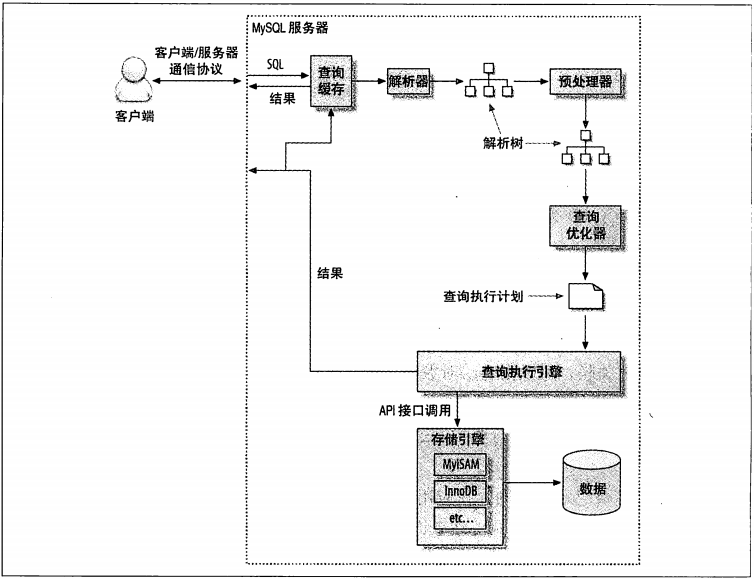

**6.1 为什么查询速度会慢**

查询的生命周期大致可按照顺序来看：从客户端，到服务器，然后在服务器上进行解析，生成执行计划，执行，并返回结果给客户端。其中“执行”可以认为是整个生命周期中最重要的阶段。这其中包括了大量为了检索数据到存储引擎的调用以及调用后的数据处理，包括排序、分组等。

在完成这些任务时，查询需要在不同的地方花费时间，包括网络、CPU计算、生成统计信息和执行计划、锁等待等操作，尤其是向底层存储引擎检索数据的调用操作，这些调用需要在内存操作、CPU操作和内存不足时导致的IO操作上消耗时间。根据存储引擎不同，可能还会产生大量的上下文切换以及系统调用。

**6.2 慢查询基础：优化数据访问**

查询性能低下最基本的原因是访问的数据太多。这类情况的查询都可通过减少访问的数据量的方式进行优化。

对于低效查询的分析步骤：

- 确认应用程序是否在检索大量超过需要的数据。这通常意味着访问了太多的行或列。

- 确认MySQL服务器层是否在分析大量超过需要的数据行。

**是否向数据库请求了不需要的数据**

有些查询会请求超过实际需要的数据，然后这些多余的数据会被应用程序丢弃。这会给MySQL服务器带来额外的负担，并增加网络开销，另外也会消耗应用服务器的CPU和内存资源。

**查询不需要的行**

- 解决方式是在这样的查询后面加上LIMIT

**多表关联时返回全部列**

- 解决方式是在列前加上表名

**总是取出全部列**

- 通常情况下禁用SELECT \*

**重复查询相同的数据**

- 当初次查询的时候将这个数据缓存起来，需要的时候从缓存中取出，这样性能更好

**MySQL是否在扫描额外的记录**

在确定查询只返回需要的数据后，接下来应检查查询为了返回结构是否扫描了过多的数据。

对于MySQL，最简单的衡量查询开销的三个指标：

- 响应时间；

- 扫描的行数；

- 返回的行数；

**响应时间**

响应时间是两个部分之和：服务时间和排队时间。服务时间是指数据库处理这个查询真正花费的时间。排队时间是指服务器因为等待某些资源而没有真正执行查询的时间——可能是等IO操作完成，也可能是等待行锁。但实际上，这两者无法细分。

在不同类型的引用压力下，响应时间并没有什么一致的规律或公式。诸如存储引擎的锁（表锁、行锁）、高并发资源竞争、硬件响应等诸多因素都会影响响应时间。

**扫描的行数和返回的行数**

分析查询时，查看该查询扫描的行数 在一定程度上能够说明该查询找到需要数据的效率。扫描的行数和返回的行数之间的比率一般在1:1到10:1之间较为合理。

**扫描的行数和访问类型**

在explain语句中的type列反应了访问类型（即MySQL决定如何查找表中的行）。访问类型有很多种，从全表扫描到索引扫描，范围扫描、唯一索引查询、常数引用等。

如果查询没有办法找到合适的访问类型，那么通常就需要增加一个合适的索引。索引能让MySQL以最高效、扫描行数最少的方式找到需要的记录。

|  |  |
| --- | --- |
| ALL | 全表扫描，通常意味着MySQL必须扫描整张表。（例外，如果查询中使用了LIMIT，Extra列种会显示"Using distinct/not exists"） |
| index | 与全表扫描一样，只是MySQL扫描表时按索引次序进行而不是行。主要优点是避免了排序，最大的缺点是要承担按索引读取整个表的开销。这通常意味着若是按随即次序访问行，开销将会非常大。 |
| range | 范围扫描就是一个有限制的索引扫描，它开始于索引里的某一点，返回匹配这个值域的行。这比全索引扫描好一些，因为他用不着遍历全部索引，显而易见的范围扫描时带有between或在where子句里带有>的查询 |
| ref | 这是一种索引访问（有时也叫做索引查找），他返回所有匹配某个单个值得行。然而，他可能会找到多个符合条件的行，因此，它是查找和扫描的混合体。此类索引访问只有当使用非唯一性索引或者唯一性索引的非唯一性前缀时才会发生。把它叫做ref是因为索引要跟某个参考值相比较。这个参考值或者是一个常数，或者是来自多表查询钱一个表的结果值。 |
| eq\_ref | 使用这种索引查找，MySQL知道最多只返回一条符合条件的记录。这个访问方法可以在MySQL使用主键或者唯一性索引查找时看到，它会将她们与某个参考值做比较。MySQL对于这类访问类型的优化做得非常好，因为他知道无须估计批评行的范围活在找到匹配行后再继续查找。 |
| const/system | 当MySQL能对查询的某部分进行优化并将其转换成一个常量时，它就会使用这个访问类型。 |
| NULL | 这种访问方式意味着MySQL能在优化阶段分解查询语句，在执行阶段甚至用不着再访问表或者索引。 |

一般MySQL能够使用如下三种方式应用where条件，从好到坏依次为：

- 在索引中使用where条件来过滤不匹配的记录。这是在存储引擎层完成的。

- 使用索引覆盖扫描（在Extra列中出现Using index）来返回记录，直接从索引中过滤不需要的记录并返回命中的结果。这是在MySQL服务器层完成的，但无须在回表查询记录。

- 从数据表中返回数据，然后过滤不满足条件的记录（在Extra列中出现Using where）。这在MySQL服务器层完成，MySQL需要先从数据表读出记录然后过滤。

如果发现查询需要扫描大量的数据但只返回少数的行，那么通常可以尝试下面的技巧去优化它：

- 使用索引覆盖扫描，把所有需要用的列都放在索引中，这样存储引擎无须回表获取对应行就可以返回结果。

- 改变库表结构。

- 重写这个复杂的查询，让MySQL优化器能够以更优化的方式执行这个查询。

**6.3 重构查询的方式**

在优化有问题的查询时，目标应该是在找到一个更优的方法获得实际需要的结果，而不是一定总是需要从MySQL获取一模一样的结果集。

**一个复杂查询还是多个简单查询**

在传统实现中，总是强调需要数据库层完成尽可能多的工作，这样做的逻辑在于以前总是认为网络通信、查询解析和优化是一件代价很高的事情。

但是这样的想法对于MySQL并不适用，MySQL从设计上让连接和断开连接都很轻量级，在返回一个小的查询结果方面很搞笑。现代网络速度比以前要快很多，无论是带宽还是延迟。所有运行多个小查询现在已经不是大问题。

MySQL内部每秒能够扫描内存中上百万行数据，相比之下，MySQL响应数据给客户端就慢得多。在其他条件都相同的时候，使用尽可能少的查询当然是更好的。但是有时候，将一个大查询分解为多个小查询是很有必要的。不过，在应用设计的时候，如果一个查询能够胜任时还写成多个独立查询是不明智的。

**切分查询**

有时候对于一个大查询我们需要“分而治之”，将大查询切分成小查询。每个查询功能完全一样，只完成一小部分，每次只完成一小部分，每次只返回一小部分查询结果。如删除旧数据的操作。

**分解关联查询**

很多高性能的应用都会对关联查询进行分解。简单地，可以对于每一个表进行一次单表查询，然后将结果在应用程序中进行关联。

用分解关联查询的方式重构查询有如下优势：

- 让缓存的效率更高。许多应用程序可以方便地缓存单表查询对应的结果对象。另外，对MySQL的查询缓存来说，如果关联中的某个表发生了变化，那么久无法使用查询缓存了。而拆分后，如果某个表很少改变，那么基于改表的查询就可以重复利用查询缓存结果了。

- 将查询分解后，执行单个查询可以减少锁的竞争。

- 在应用层做关联，可以更容易对数据库进行拆分，更容易做到高性能和可扩展。

- 查询本身效率也可能会有所提升。

- 可以减少冗余记录的查询。在应用层做关联查询，意味着对于某条记录应用只需要查询一次，而在数据库中做关联查询，则可能需要重复地访问一部分数据。这样的重构还可能会减少网络和内存的消耗。

- 这样做相当于在应用中实现了哈希关联，而不是使用MySQL的嵌套循环关联。某些场景哈希关联的效率要高很多。

**6.4 查询执行的基础**

**查询执行路径**

- 客户端发送一条查询给服务器；

- 服务器先检查查询缓存，如果命中缓存，则立即返回存储在缓存中的结果。否则进入下一阶段；

- 服务器端进行SQL解析、预处理、再由优化器生成对应的执行计划；

- MySQL根据优化器生成的执行计划，调用存储引擎的API来执行查询；

- 将结果返回给客户端；

**MySQL客户端/服务器通信协议**

MySQL客户端和服务器之间的通信协议是“半双工”的（即 在任何时刻，要么是由服务器向客户端发送数据，要么是由客户端向服务器发送数据，这两个动作不能同时发生）。优点：简单快速；缺点：无法进行流量控制。

查询状态：对于一个MySQL连接，或者说一个线程，任何时刻都有一个状态，该状态标识MySQL当前正在做什么。命令：show full processlist。

- Sleep：线程正在等待客户端发送新的请求。

- Query**：**线程正在执行查询或者正在将结果发送给客户端。

- Locked**：**在MySQL服务器曾，该线程正在等待表锁。在存储引擎级别实现的锁，例如InnoDB的行锁，并不会提现在线程状态中。对于M有ISAM来说这是一个比较典型的状态。

- Analyzing and statistics： 线程正在收集存储引擎的统计信息，并生成查询执行计划。

- Copying to tmp table [on disk]：线程正在执行查询，并且将其结果集都复制到一个临时表中，这种状态一般要么是在做group by操作，是文件排序操作，或者是union操作。如果这个状态后面还有on disk标记，则表示MySQL正在将一个内存临时表放在磁盘上。

- Sorting result：线程正在对结果集进行排序。

- Sending data：线程可能在多个状态之间传送数据，或者在生成结果集，或者在向客户端返回数据。

**查询缓存**

缓存是通过一个对大小写敏感的哈希查找实现的。如果当前的查询恰好命中缓存，那么在返回查询结果之前MySQL还会检查一次用户权限。

**查询优化处理**

**语法解析器和预处理**

MySQL通过关键字将SQL语句进行解析，并生成一棵对应的"解析树"，MySQL解析器将使用MySQL语法规则验证和解析查询。例如，它将验证是否使用错误的关键字，或者使用关键字的顺序是否正确，再或者它还会验证引号是否能前后正确匹配。

预处理器则根据一些MySQL规则进一步检查解析树是否合法，例如，这里将检查数据表和数据列是否存在，还会解析名字和别名，看看它们是否有歧义。下一步预处理器会验证权限。

**查询优化器**

在语法树合法的基础上，优优化器将其转化成执行计划。一次查询可以有很多种执行方式，最后都返回相同的结果。优化器的作用就是找到这其中最好的执行计划。

MySQL使用基于成本的优化器，它将尝试预测一个查询是哟弄个某个执行计划时的成本，并选择其中成本最小的一个。可通过查询当前会话的last\_query\_cost的值来得知MySQL计算的当前查询的成本。SHOW STATUS LIKE 'last\_query\_cost'。返回值表示MySQL的优化器认为大概需要 做N个数据页的随机查找才能完成查询。

这是根据一系列的统计信息计算得出的：每个表或者索引的页面个数、索引的基数（索引中不同值得数量）、索引和数据行的长度、索引分布情况。优化器在评估成本时并不考虑任何层面的缓存，它假设读取任何数据都需要一次磁盘IO。

有如下多种原因会导致MySQL优化器选择错误的执行计划：

- 统计信息不准确。MySQL依赖存储引擎提供的统计信息来评估成本，但是有的存储引擎提供的信息是准确的，有的变差可能非常大。

- 执行计划中的成本估算不等同实际执行的成本。所以即使统计信息精确，优化器给出的执行计划也可能不是最优的。

- MySQL只是基于其成本模型下载最优的执行计划，而有些时候这并不是最快的执行方式，

- MySQL从不考虑其他并发执行的查询，这可能会影响到当前查询的速度。

- MySQL也并不是任何时候都是基于成本的优化。有时也会基于一些固定的规则。

- MySQL不会考虑不受其控制的操作的成本，例如执行存储过程或者用户自定义函数的成本。

- 优化器有时无法估算所有可能的执行计划，所以它可能错过实际上最优的执行计划。

MySQL查询优化器是一个非常复杂的不见，它使用了很多优化策略来生成一个最优的执行计划。优化策略可简单分为两种，一种是静态优化，一种是动态优化。

静态优化可以直接对解析树进行分析，并完成优化。例如，优化器可以通过一些简单的代数变换将WHERE条件转换成另一种等价形式。静态优化不依赖于特别的数值，如where条件中带入的一些常数等。静态优化在第一次完成后就一直有效，即使使用不同的参数重复执行查询也不会发生变化。可以认为这是一种"编译时优化"。

动态优化则和查询的上下文有关，也可能和很多其他因素有关，例如where条件中的取值、索引中条目对应的数据行数等。这需要在每次查询的时候都重新评估，可以认为是"运行时优化"。

在执行语句和存储过程的时候，动态优化和静态优化的区别非常重要。MySQL对查询的静态优化只需要做一次，但对查询的动态优化则在每次执行时都需要重新评估。有时候甚至在查询的执行过程中也会重新优化。

下面是一些MySQL能够处理的优化类型：

- 重新定义关联表的顺序。数据表的关联并不总是按照在查询中指定的顺序进行。

- 将外连接转化成内连接。并不是所有的outer join语句都必须以外连接的方式执行。诸多因素，例如where条件、库表结果都可能会让外连接等价于一个内连接。MySQL能够识别这点并重写查询，让其可以调整关联顺序。

- 使用等价变换规则。MySQL可以使用一些等价变化来简化并规范表达式。它可以合并和减少一些比较，还可以移除一些恒成立和一些恒不成立的判断。

- 优化COUNT()、MIN()、MAX()。索引和列是否可为空通常可以帮助MySQL优化这类表达式。例如，要找到某一列的最小值，只需要查询对应B-Tree索引最左端的记录，MySQL剋直接获取所有的第一行记录。在优化器生成执行计划的时候就可以利用这一点，在B-Tree索引中，优化器会将这个表达式作为一个常数对待。如果MySQL使用了这种类型的优化，那么在EXPLAIN中就可以看到"Select tables optimized away"，它表示优化器已经从执行计划中移除了该表，并以一个常数取而代之。

- 预估并转化为常量表达式。当MySQL检测到一个表达式可以转化为常数的时候，就会一直把该表达式作为常数进行优化处理。

- 覆盖索引扫描。当索引中的列包含所有查询中需要使用的列的时候，MySQL就可以使用索引返回需要的数据，而无须查询对应的数据行。

- 子查询优化。MySQL在某些情况下可以将子查询转换成一种效率更高的形式，从而减少多个查询多次对数据进行访问。

- 提前终止查询。在发现已经满足查询需求的时候，MySQL总是能够立即终止查询。例如查询中包含LIMIT子句，或者where条件不成立，这时MySQL可以立即返回一个空结果。

- 等值传播。如果两个列的值通过等式关联，那么MySQL能够把其中一个列的where条件传递到另一列上。

- 列表IN()的比较。在很多数据库系统中，IN()完全等同于多个OR条件的子句，因为这两个是完全等价的。在MySQL中这点事不成立的，MySQL将IN()列表中的数据线进行排序，然后通过二分查找的方式来确定列表中的值是否满足条件，这是一个o(log n)复杂度的操作，等家底转化成OR查询的复杂度为O(n)，对于IN()列表中有大量取值的时候，MySQL的处理速度将会更快。

**数据和索引的统计信息**

在服务器层有查询优化器，却没有保存数据和索引的统计信息。统计信息由存储引擎层实现。MySQL查询优化器在生成查询的执行计划时，需要想存储引擎获取相应的统计信息。包括：每个表或者索引有多少个页面、每个表的每个索引的技术是多少、数据行和索引长度、索引的分布信息等。优化器根据这些信息来选择一个最优的执行计划。

**MySQL如何执行关联查询**

MySQL中的"关联JOIN"一词所包含的意义比一般意义上理解的要更广泛。MySQL认为任何一次查询都是一次"关联"——并不仅仅是一个查询需要到两个表匹配才叫关联，所以在MySQL中，每一个查询，每一个片段（包括子查询，甚至基于单表的select）都可能是关联。

对于UNION查询，MySQL先将一系列的单个查询结果放到一个临时表中，然后再重新读出临时表数据来完成UNION查询。在MySQL的概念中，每个查询都是一次关联，所以读取结果临时表也是一次关联。

MySQL关联执行的策略：MySQL对任何关联都执行嵌套循环操作，即MySQL先在一个表中循环去除单条数据，然后再嵌套循环到下一个表中寻找匹配的行，依次下去，直到找到所有表中匹配的行为止（类似foreach嵌套foreach）。然后根据各个表匹配的行，返回查询中需要的各个列。MySQL会尝试在最后一个关联表中找到所有匹配的行，如果最后一个关联表无法找到更多的行以后，MySQL返回到上一层次关联表，看是否能够找到更多的匹配记录，以此类推迭代执行。

MySQL对所有的类型的查询都是同样的方式运行。例如，MySQL在FROM子句中遇到子查询时，先执行子查询并将其结果放到一个临时表（缺点：临时表没有索引）中，然后将这个临时表当作一个普通表（派生表）对待。MySQL在执行UNIION查询时也使用类似的临时表，在遇到右外连接时，MySQL会将其改写成等价的左外连接。

**执行计划**

MySQL生成查询的一棵指令树，然后通过存储引擎执行完成这棵指令树并返回结果。最终的执行计划包含了重构查询的全部信息。对某个查询执行EXPLAIN EXENDED后，再执行SHOW WARNINGS，就可以看到重构出的查询。

MySQL如何实现多表关联：

**关联查询优化器**

MySQL优化器最重要的一部分就是关联查询优化，它决定了多个表关联时的顺序。通常多表关联的时候，可以有多种不同的关联顺序来获得相同的执行结果。关联查询优化器则通过评估不同顺序时的成本来选择一个代价最小的关联顺序（更少的嵌套循环和回溯操作）。顺序第一的表可被称为驱动表。可使用STRAIGHT\_JOIN关键字让MySQL按照SQL语句书写的顺序执行。

**排序优化**

当不能使用索引生成排序结果的时候，MySQL需要自己进行排序，如果数据量小则在内存中进行，如果数据量大则需要使用磁盘，不过MySQL将这个过程统一称为文件排序（filesort）。

如果需要排序的数据量小于"排序缓冲区"，MySQL使用内存进行"快速排序"操作。如果内存不够排序，那么MySQL会先将数据分块，对每个独立的块使用"快速排序"进行排序，并将各个块的排序结果存放在磁盘上，然后将各个排好序的块进行合并（merge），最后返回排序结果。

MySQL在进行文件排序的时候需要使用的临时存储空间可能会比想象的要大得多（即 排序消耗的临时空间比磁盘上的原表要大很多倍）。原因在于MySQL在排序时，对每一个排序记录都会分配一个足够长的定长空间来存放。这个定长空间必须足够长以容纳其中最长的字符串。

在关联查询的时候如果需要排序，MySQL会分两种情况来处理这样的文件排序。如果order by子句中的所有列都来自关联的第一个表（驱动表），那么MySQL在关联处理第一个表的时候就进行文件排序，EXPLAIN的Extra字段会有"Using filesort"信息。除此之外的所有情况，MySQL都会先将关联的结果存放到一个临时表中，然后在所有的关联都结束后，再进行文件排序。这种情况下，在MySQL的EXPLAIN结果的Extra字段可以看到"Using temporaya, Using filesort"信息。如果查询中有LIMIT的话，LIMIT也会在排序之后应用，所以即使需要返回较少的数据，临时表和需要排序的数据量仍然会非常大。

新版本的MySQL对此做了很多改进。当只需要返回部分排序结果的时候，MySQL不再对所有的结果进行排序，而是根据实际情况，选择抛弃不满足条件的结果，然后再进行排序。

**查询执行引擎**

在解析和优化阶段，MySQL将生成查询对应的执行计划（MySQL的执行计划是一个数据结构），MySQL的查询执行引擎则根据这个执行计划来完成整个查询。

在根据执行计划逐步执行的过程中，有大量的操作需要通过调用存储引擎实现的接口来完成。

**返回结果给客户端**

查询执行的最后一个阶段是将结果返回给客户端。即使查询不需要返回结果集给客户端，MySQL仍然会返回这个查询的一些信息，如该查询影响到的行数。

如果查询可以被缓存，那么MySQL在这个阶段也会将结果存放在查询缓存中。

MySQL将结果集返回客户端是一个增量、逐步返回的过程。例如，在关联查询操作中，一旦服务器处理完最后一个关联表，开始生成第一条结果时，MySQL就可以开始向客户端逐步返回结果集了。

**6.5 MySQL查询优化器的局限性**

**UNION的限制**

有时，MySQL无法将限制条件从外层"下推"到内层，这使得原本能够限制部分返回结果的条件无法应用到内层查询的优化上。如果希望union的各个子句能够根据limit只取部分结果集，或者希望先排好序再合并结果集的话，就需要在union的各个子句中分别使用这些子句。

(

SELECT

order\_id,

create\_time

FROM

order\_a

WHERE

phone = 12345

ORDER BY

create\_time DESC

LIMIT 10

)

UNION ALL

(

SELECT

order\_id,

create\_time

FROM

order\_b

WHERE

phone = 12345

ORDER BY

create\_time DESC

LIMIT 10

)

ORDER BY

create\_time DESC

LIMIT 10

**索引合并优化**

当where子句中包含多个负责条件的时候，MySQL能够访问单个表的多个索引以合并和交叉过滤的方式来定位需要查找的行。

**6.6 查询优化器的提示（hint）**

如果对优化器选择的执行计划不满意，可以使用优化器提供的几个提示（hint）来控制最终的执行计划。

- HIGH\_PRIORITY 和 LOW\_PRIORITY：控制MySQL访问某个数据表的队列顺序，仅对使用表锁的存储引擎有效。不支持InnoDB。

- DELAYED：这个提示对insert和replace有效。MySQL会将使用该提示的语句立即返回给客户端，比ing将插入的行数据放入到缓存区，然后再表空闲时批量将数据写入。日志系统使用这样的提示非常有效，或者是其他需要写入大量数据但是客户端却不需要等待单条语句完成IO的应用。不支持InnoDB。

- STRAIGHT\_JOIN：这个提示可以放置在select语句的select关键字之后，也可以放置在任何两个关联表的名字之间。第一个用法是让查询中的所有的表按照在语句中出现的顺序进行关联。第二个用法则固定其前后两个表的关联顺序。

- SQL\_SMALL\_RESULT 和 SQL\_BIG\_RESULT：这两个提示只对select语句有效。他们告诉优化器对group by或者distinct查询如何使用临时表及排序。SQL\_SMALL\_RESULT告诉优化器结果集会很小，可以将结果放在内存中的索引临时表，以避免排序操作。SQL\_BIG\_RESULT则告诉优化器结果集可能会非常大，建议使用磁盘临时表做排序操作。

- SQL\_BUFFER\_RESULT：这个提示告诉优化器将查询结果放入到一个临时表，然后尽可能快地释放表锁。代价是需要更多的内存。

- SQL\_CACHE 和 SQL\_NO\_CACHE：这个提示告诉MySQL这个结果集是否应该缓存在查询缓存中。

- SQL\_CALC\_FOUND\_ROWS：它会让MySQL返回的结果集包含更多的信息。查询中加上该提示MySQL会计算出去LIMIT子句后这个查询要返回的结果集的总数，而实际上只返回limit要求的结果集。

- FOR UPDATE 和 LOCK IN SHARE MODE：控制select语句的锁机制。

- USE INDEX、IGNORE INDEX 和 FORCE INDEX：告诉优化器使用或者不使用哪些索引来查询记录。

**6.7 优化特定类型的查询**

**优化COUNT()查询**

COUNT()是一个特殊的函数，有两个非常不同的作用：他可以统计某个列值的非空（值不为NULL）数量，也可以统计行数。

最简单的就是当我们使用COUNT(\*)的时候，这种情况下通配符\*并不是统计所有的列，实际上，它会忽略所有的列而直接统计所有的行数。

由于COUNT()需要扫描大量的行，可以考虑添加汇总表（计数器）。

**优化关联查询**

- 确保ON或者USING子句中的列上有索引。在创建索引的时候就要考虑到关联的顺序。

- 确保任何的GROUP BY和ORDER BY中的表达式只涉及到一个表中的列，这样MySQL才有可能使用索引来优化这个过程。

**优化子查询**

尽可能使用关联查询来代替子查询。注意，MySQL5.6会将子查询直接重写为关联查询。

**优化 GROUP BY 和 DISTINCT**

在很多场景下，MySQL都是用同样的办法优化这两种查询。MySQL优化器会在内部处理的时候相互转化这两类查询。他们都可以使用索引来优化，这也是最有效的优化办法。

当无法使用索引时，GROUP BY使用两种策略来完成：使用临时表或者文件排序来做分组，对于任何查询语句，这两种策略的性能都有可以提升的地方。可以通过使用提示SQL\_BIG\_RESULT或SQL\_SMALL\_RESULT来让优化器按照你希望的方式运行。

如果需要对关联查询做分组，并且是按照查找表中的某个列进行分组，那么通常采用查找表的标识列分组的效率会比其他列更高。

如果没有通过order by子句显式地指定拍序列，当查询使用group  by子句的时候，结果集会自动按照分组的字段进行排序，如果不关心结果集的顺序，而这种默认排序又导致了需要文件排序，则可以使用order by null让MySQL不在进行文件排序。也可以在group by子句中直接使用desc或者asc关键字，使分组的结果集按需要的方向排序。

**优化 GROUP BY WITH ROLLUP**

分组查询的一个变种就是要求MySQL对返回的分组结果再做一次超级聚合。可以使用with rollup子句来实现这种逻辑。

最好的优化方法是尽可能将with rollup功能转移到应用程序中处理。

**优化 LIMIT 分页**

分页操作通常会使用limit加上偏移量的办法实现，同时再加上合适的order by子句。但这会出现一个常见问题：当偏移量非常大的时候，它会导致MySQL扫描大量不需要的行然后再抛弃掉。

一个最简单的方法是尽可能地使用索引覆盖扫描，而不是查询所有的列。然后根据需要做一次关联操作再返回所需的列。

有时候也可以将limit查询转换为已知位置的查询，让MySQL通过范围扫描获得对应的结果。

**优化 UNION 查询**

MySQL总是通过创建并填充临时表的方式来执行UNION查询。因此很多优化策略在UNION查询中都没有很好使用。经常需要手工地将WHERE、LIMIT、ORDER BY等子句"下推"到UNION的各个子查询中，以便优化器可以充分利用这些条件进行优化。

除非确实需要服务器消除重复的行，否则就一定要使用UNION ALL。如果没有ALL关键字，MySQL会给临时表加上DISTINCT选项，这会导致地整个临时表的数据做唯一性检查。这样做的代价非常高。

**使用用户自定义变量**

SET @val := 1;

SET @maxId := (SELECT MAX(id) FROM table\_name );

**使用自定义变量的场景限制**

- 使用自定义变量的查询，无法使用查询缓存。
- 不能再使用常量或者标识符的地方使用自定义变量，例如表名、列明和LIMIT子句中。
- 用户自定义变量的生命周期是在一个连接（session）中有效，所以不能用它们来做连接间的通信。
- 如果使用连接池或者持久化连接，自定义变量可能让看起来毫无关系的代码发送交互（如果是这样，通常是代码bug或者连接池bug）。
- 不能显式地声明自定义变量的数据类型。
- MySQL优化器在某些场景下可能会将这些变量优化掉。
- 赋值的顺序和赋值的时间点并不总是固定的，这依赖于优化器的决定。
- 赋值符号:=的优先级非常低，所以赋值表达式应该使用明确的括号。
