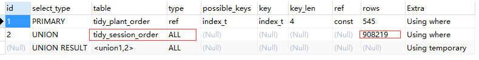
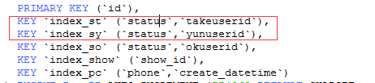
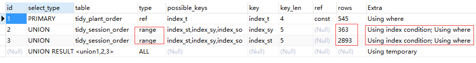
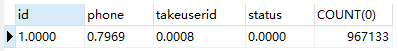

这周就要从泰笛离职了，在公司内部的wiki上，根据公司实际的项目，写了一些mysql的优化方法，供小组里的小伙伴参考下，没想到大家的热情很高，还专门搞了个ppt讲解了一下。

举了三个大家很容易犯错的地方，之前项目中也存在，后期修正了。

**MySQL优化实例（一）**

以我们项目中一个sql语句为例，展示sql语句优化的步骤。

webService项目中有个getWashXiaogeId的封装方法，用于分配配送小哥。

其中，有一段逻辑是查询某个小哥当前的配送订单量（绿植+洗涤）。查询慢查询日志时发现，这个sql的执行效率很差。

```
-- 定义变量
SET @todayZero = DATE_FORMAT(now(), '%Y-%m-%d 00:00:00');
SET @tomorrowZero = DATE_FORMAT(
    FROM_UNIXTIME(
        UNIX_TIMESTAMP(now()) + 86400
    ),
    '%Y-%m-%d 00:00:00'
);
SET @takeUserId = 255;
-- 查询某个小哥当前的配送数
SELECT
    count(0) AS count
FROM
    `tidy_plant_order`
WHERE
    `current_takeuserid` = @takeUserId
AND `create_datetime` > @todayZero
AND `create_datetime` < @tomorrowZero
UNION ALL
    SELECT DISTINCT
        count(*) AS count
    FROM
        `tidy_session_order`
    WHERE
        (
            `takeuserid` = @takeUserId
            OR `yunuserid` = @takeUserId
        )
    AND `create_datetime` > @todayZero
    AND `create_datetime` < @tomorrowZero
```

我们在explain这个select语句发现：



在查询洗涤订单表的时候，MySQL进行了全表扫描，这意味着MySQL必须扫描整张表，从头到尾，去找到需要的行。

这条sql优化的地方很多，例如：

0）可以将or关键字改为in或者union；

1）可以将union拆分成N条简单的sql查询，避免MySQL使用到临时表，在逻辑层求和；

2）可以根据实际的业务模型，添加索引或修改当前错误的索引；

3）若2）代价较高，则可以基于现有的索引，优化sql语句，尽可能使用到目前已经存在的索引；

我们将tidy\_session\_order的现有索引贴出：



发现，有两个多列索引index\_st和index\_sy有我们需要的字段，即takeuserid和yunuserid。（这两个索引本身是有问题的，status的选择性比takeuserid/yunuserid要差，如果要建多列索引，也是应该takeuserid/yunuserid为第一列，status为第二列）。

所以我们将现有的sql优化成以下的样子：

```
-- 定义变量
SET @todayZero = DATE_FORMAT(now(), '%Y-%m-%d 00:00:00');
SET @tomorrowZero = DATE_FORMAT(
    FROM_UNIXTIME(
        UNIX_TIMESTAMP(now()) + 86400
    ),
    '%Y-%m-%d 00:00:00'
);
SET @takeUserId = 255;
-- 查询某个小哥当前的配送数
SELECT
    COUNT(*) AS count
FROM
    tidy.`tidy_plant_order`
WHERE
    `current_takeuserid` = @takeUserId
AND `create_datetime` BETWEEN @todayZero
AND @tomorrowZero
UNION ALL
    SELECT DISTINCT
        COUNT(*) AS count
    FROM
        tidy.`tidy_session_order`
    WHERE
        `status` IN (0, 1, 2, 3, 4, 5, 7, 9, 10, 11, 12)
    AND `yunuserid` = @takeUserId
    AND `takeuserid` != @takeUserId
    AND `create_datetime` BETWEEN @todayZero
    AND @tomorrowZero
    UNION ALL
        SELECT DISTINCT
            COUNT(*) AS count
        FROM
            tidy.`tidy_session_order`
        WHERE
            `status` IN (0, 1, 2, 3, 4, 5, 7, 9, 10, 11, 12)
        AND `takeuserid` = @takeUserId
        AND `create_datetime` BETWEEN @todayZero
        AND @tomorrowZero
```

explain这个sql发现：



查询时间从原来的0.5-1s 降至了 0.01-0.02s。

**MySQL优化实例（二）**

本实例以短信验证码为例，展示创建**覆盖索引**的优势。

**覆盖索引的定义：**

如果一个索引包含（或者说覆盖）所有需要查询的字段的值，我们就称之为“覆盖索引”。

**实例：**

我们的app在登陆时，需要获取验证码，验证通过才能使用我们的服务。在发送短信的同时，我们会在记录表中插入一个条记录，用户在输入验证码后，以此来判断用户输入值是否正确。

```
SET @phone = 13651999158;
SET @code = 123456;
SELECT
    count(0)
FROM
    tidy_verification_code_log
WHERE
    phone = @phone
AND `code` = @code
AND `timestamp` > UNIX_TIMESTAMP(NOW()) - 120000;
```

我们explain发现：


MySQL通过全表扫描的方式，查找需要的那条记录，效率极差。

我们可以通过创建一个覆盖索引的方式来进行优化。

```
alter table tidy_verification_code_log add index`index_pct`(`phone`, `code`, `timestamp`);
```

将此前的SQL优化成：

```
SET @phone = 13651999158;
SET @code = 123456;
SELECT
    `timestamp`
FROM
    tidy_verification_code_log
WHERE
    phone = @phone
AND `code` = @code
-- 然后在逻辑层判断timestamp是否超时
```

explain显示：


在Extra列中，如果出现Using index，则表示MySQL将使用覆盖索引，以避免访问表。

**覆盖索引的优势：**

当索引中的列包含所有查询中需要使用的列的时候，MySQL就可以使用索引返回需要的数据，而无须查询对应的数据行。由于InnoDB的聚簇索引特性，覆盖索引对InnoDB表特别有用。InnoDB的二级索引在叶子节点中保存了行的主键值，所以如果二级索引能够覆盖查询，则可以避免对主键索引的二次查询。

**MySQL优化实例（三）**

本实例展示如何正确地创建一个多列索引（或者称为联合索引）。

为每个列创建独立的索引或者按照错误的顺序创建多列索引，是常见的错误索引策略。

**索引的选择性：**

索引的选择性是指，不重复的索引值（也称为基数，cardinality）和数据表的记录的总数（#T）的比值，范围从1/#T到1之间。索引的选择性越高则查询效率越高，因为选择性高的所以可以让MySQL在查找时过滤掉更多的行。唯一索引的选择性是1，这是最好的索引选择性，性能也是最好的。

**错误示例1，不应该建多列索引：**

tidy\_barcode表中有一个多列索引index\_si：

```
CREATE TABLE `tidy_barcode` (
  `id` int(11) NOT NULL AUTO_INCREMENT,
  `orderid` int(11) NOT NULL COMMENT '订单号',
  `session_id` bigint(20) NOT NULL DEFAULT '0' COMMENT '预订单编号',
  `gpid` int(11) NOT NULL DEFAULT '0' COMMENT '洗涤衣物的总分类',
  `gcid` int(11) NOT NULL DEFAULT '0' COMMENT '洗涤衣物的子分类',
  `goodid` int(11) NOT NULL COMMENT '商品id',
  `goods` varchar(100) NOT NULL DEFAULT '' COMMENT '洗涤衣物的称呼',
  `goodstype` varchar(50) NOT NULL DEFAULT '' COMMENT '洗涤衣物的类型',
  `num` decimal(4,2) unsigned NOT NULL,
  `price` decimal(11,2) NOT NULL DEFAULT '0.00' COMMENT '洗涤衣物价格',
  `disprice` decimal(11,2) NOT NULL DEFAULT '0.00' COMMENT '洗涤衣物折扣价',
  `realprice` decimal(11,2) NOT NULL DEFAULT '0.00' COMMENT '洗涤衣物实际价',
  `goods_item_id` bigint(20) NOT NULL DEFAULT '0' COMMENT '订单明细表对应的ID',
  `barcode` varchar(30) NOT NULL DEFAULT '' COMMENT '条码',
  `originbarcode` varchar(30) NOT NULL DEFAULT '' COMMENT '初始条码',
  `goodimg` varchar(512) NOT NULL DEFAULT '' COMMENT '商品图片',
  `goodinfo` varchar(100) NOT NULL DEFAULT '' COMMENT '洗涤衣物的备注信息',
  `status` tinyint(2) NOT NULL DEFAULT '0' COMMENT '每件衣物的状态',
  `ifscan` tinyint(1) NOT NULL DEFAULT '0' COMMENT '是否已扫描',
  `ifnormal` tinyint(4) DEFAULT NULL COMMENT '0无异常，1异常，2异常修复，3取消，4改码，5加件',
  `changemark` varchar(100) NOT NULL DEFAULT '' COMMENT '修改备注',
  `mark` varchar(100) NOT NULL COMMENT '异常备注',
  `userid` int(11) NOT NULL DEFAULT '0' COMMENT '异常提交者',
  `createdatetime` datetime NOT NULL DEFAULT '0000-00-00 00:00:00' COMMENT '创建时间',
  `goods_mark` int(10) NOT NULL DEFAULT '1' COMMENT '1、正常价格衣物。2、童装类型衣物',
  PRIMARY KEY (`id`),
  KEY `index_se` (`session_id`),
  KEY `index_si` (`status`,`ifnormal`),
  KEY `index_b` (`barcode`)
) ENGINE=InnoDB AUTO_INCREMENT=591457 DEFAULT CHARSET=utf8;
```

status，ifnormal的字段本身选择性就很差，不适合作为索引或者多列索引的第一列，就像我们一般不会在性别这一列添加索引（当然也有例外）。

**错误示例2，多列索引顺序错误：**

```
tidy_session_order表中有一个多列索引index_st：
```

```
CREATE TABLE `tidy_session_order` (
  `id` bigint(20) NOT NULL AUTO_INCREMENT,
  `show_id` bigint(20) NOT NULL DEFAULT '0' COMMENT '订单编号',
  `phone` bigint(15) NOT NULL DEFAULT '0' COMMENT '用户手机号',
  `cname` varchar(30) NOT NULL DEFAULT '' COMMENT '客户名',
  `totalprice` decimal(12,2) NOT NULL DEFAULT '0.00' COMMENT '洗涤总价',
  `disprice` decimal(12,2) NOT NULL DEFAULT '0.00' COMMENT '折扣价格',
  `realprice` decimal(12,2) NOT NULL DEFAULT '0.00' COMMENT '实际价格',
  `ispay` tinyint(1) NOT NULL DEFAULT '0' COMMENT '是否支付：0为未支付；1为已支付；',
  `integral` int(11) NOT NULL DEFAULT '0' COMMENT '积分',
  `shou_serverid` int(11) NOT NULL DEFAULT '0' COMMENT '收去网点编号',
  `song_serverid` int(11) NOT NULL DEFAULT '0' COMMENT '派送网点编号',
  `lat` varchar(20) NOT NULL DEFAULT '0' COMMENT '经度',
  `lng` varchar(20) NOT NULL DEFAULT '0' COMMENT '纬度',
  `city_id` int(6) NOT NULL DEFAULT '0' COMMENT '城市编号',
  `shou_address` varchar(100) NOT NULL DEFAULT '' COMMENT '收件地址',
  `song_address` varchar(100) NOT NULL DEFAULT '' COMMENT '送件地址',
  `coe_state` int(11) NOT NULL DEFAULT '0' COMMENT '多状态标示 ',
  `is_appoint` tinyint(1) NOT NULL DEFAULT '0' COMMENT '是否为预约订单 0为非预约 1为预约订单',
  `appoint_datetime` datetime NOT NULL DEFAULT '0000-00-00 00:00:00' COMMENT '预约的时间点',
  `equ_type` char(10) NOT NULL DEFAULT '' COMMENT '设备类型 ios 、android',
  `equ_id` varchar(60) NOT NULL DEFAULT '' COMMENT '设备唯一标识',
  `equ_info` varchar(255) NOT NULL DEFAULT '' COMMENT '设备信息 json格式类型',
  `create_datetime` datetime NOT NULL DEFAULT '0000-00-00 00:00:00' COMMENT '创建日期',
  `take_datetime` datetime NOT NULL DEFAULT '0000-00-00 00:00:00' COMMENT '取件时间',
  `order_id` int(11) NOT NULL DEFAULT '0' COMMENT '订单ID',
  `status` tinyint(2) NOT NULL DEFAULT '0' COMMENT '订单状态对应tidy_base_info表里的pid=18信息',
  `previsit_datetime` datetime NOT NULL DEFAULT '0000-00-00 00:00:00' COMMENT '预计上门时间',
  `lry_datetime` datetime NOT NULL DEFAULT '0000-00-00 00:00:00' COMMENT '送洗时间',
  `sor_datetime` datetime NOT NULL DEFAULT '0000-00-00 00:00:00' COMMENT '分拣时间',
  `yun_datetime` datetime NOT NULL DEFAULT '0000-00-00 00:00:00' COMMENT '派送时间',
  `done_datetime` datetime NOT NULL DEFAULT '0000-00-00 00:00:00' COMMENT '订单的完成时间；即为status为4时的时间点',
  `done_type` tinyint(1) NOT NULL DEFAULT '0' COMMENT '签收类型 1为图片签收 2为音频签收',
  `done_verify` varchar(255) NOT NULL DEFAULT '' COMMENT '签收文件的保存路径',
  `operator_id` int(11) NOT NULL DEFAULT '0' COMMENT '操作人 0为用户自己取消 其他为操作人的编号',
  `mark` varchar(100) NOT NULL DEFAULT '' COMMENT '备注信息',
  `evaluation` tinyint(1) NOT NULL DEFAULT '0' COMMENT '评价星级；1为非常差；2为差；3为一般；4为满意；5为非常满意；',
  `evaluation_mark` varchar(60) NOT NULL DEFAULT '' COMMENT '评价内容:50个字以内；',
  `evaluation_datetime` datetime NOT NULL DEFAULT '0000-00-00 00:00:00' COMMENT '评价的时间',
  `takeuserid` int(11) NOT NULL DEFAULT '0' COMMENT '取件人id',
  `okuserid` int(11) NOT NULL DEFAULT '0' COMMENT '加工人id',
  `yunuserid` int(11) NOT NULL DEFAULT '0' COMMENT '送件人id',
  `ifnormal` tinyint(1) NOT NULL DEFAULT '0' COMMENT '是否异常',
  `version` varchar(50) NOT NULL DEFAULT '' COMMENT '版本标识:1.5',
  `is_cash` tinyint(1) NOT NULL DEFAULT '0' COMMENT '标记是否现金支付',
  `is_del` tinyint(1) NOT NULL DEFAULT '0' COMMENT '标注订单是否删除 1为是 0为否',
  `order_source` varchar(20) NOT NULL DEFAULT '泰笛' COMMENT '订单来源',
  `third_discount` decimal(12,2) NOT NULL DEFAULT '0.00' COMMENT '三方优惠金额,现金支付时扣除该金额',
  `settle_accounts` tinyint(1) NOT NULL DEFAULT '0' COMMENT '第三方订单是否已结算',
  `modify_datetime` timestamp NOT NULL DEFAULT CURRENT_TIMESTAMP ON UPDATE CURRENT_TIMESTAMP COMMENT '数据发生修改的时间',
  `abnormal` int(2) DEFAULT '0' COMMENT '异常标记，0为正常状态,1为部分返洗，2为全部返洗',
  `ispart` int(1) NOT NULL DEFAULT '0' COMMENT '是否部分签收',
  `is_sign` tinyint(1) NOT NULL DEFAULT '0' COMMENT '客户是否签收',
  `isperiod` tinyint(1) NOT NULL DEFAULT '0' COMMENT '是否周期洗 1为true 0为false',
  PRIMARY KEY (`id`),
  KEY `index_st` (`status`,`takeuserid`),
  KEY `index_sy` (`status`,`yunuserid`),
  KEY `index_so` (`status`,`okuserid`),
  KEY `index_show` (`show_id`),
  KEY `index_pc` (`phone`,`create_datetime`)
) ENGINE=InnoDB AUTO_INCREMENT=4774982 DEFAULT CHARSET=utf8 ROW_FORMAT=DYNAMIC COMMENT='洗涤预订单表';
```

```
takeuserid的选择性比status要大，如果一定要创建这两个字段的多列索引的话，takeuserid在第一列，status在第二列。
```

通过下面这个SQL即可比较多个字段的选择性差异：

```
SELECT
    COUNT(DISTINCT id) / COUNT(0) AS id,
    COUNT(DISTINCT phone) / COUNT(0) AS phone,
    COUNT(DISTINCT takeuserid) / COUNT(0) AS takeuserid,
    COUNT(DISTINCT `status`) / COUNT(0) AS `status`,
    COUNT(0)
FROM
    tidy_session_order
```

查询结果显示：



**错误示例3，滥用多列索引：**

tidy\_api\_log表主要作用是，通过订单号或者手机号来查询相关的接口调用日志。表中index\_op索引的创建时错误的。

```
CREATE TABLE `tidy_api_log` (
  `id` bigint(20) NOT NULL AUTO_INCREMENT,
  `phone` bigint(20) NOT NULL DEFAULT '0' COMMENT '手机号',
  `order_id` bigint(20) NOT NULL DEFAULT '0' COMMENT '订单号',
  `api_controller` varchar(50) NOT NULL DEFAULT '' COMMENT '控制器',
  `api_action` varchar(50) NOT NULL DEFAULT '' COMMENT '方法名 ',
  `input_params` varchar(2000) NOT NULL DEFAULT '' COMMENT '输入参数',
  `output_message` varchar(255) NOT NULL DEFAULT '' COMMENT '输出信息',
  `output_params` varchar(2000) NOT NULL DEFAULT '输出参数',
  `output_status` tinyint(1) NOT NULL DEFAULT '1' COMMENT '调用状态,1成功or0失败',
  `create_datetime` timestamp NOT NULL DEFAULT '0000-00-00 00:00:00' COMMENT '记录插入时间',
  PRIMARY KEY (`id`),
  KEY `index_op` (`order_id`,`phone`)
) ENGINE=InnoDB AUTO_INCREMENT=2542672 DEFAULT CHARSET=utf8 COMMENT='v2.0接口调用日志';
```

根据上述的业务表述，应该分别对order\_id和phone创建独立的索引或去其他字段联合建立多列索引。
