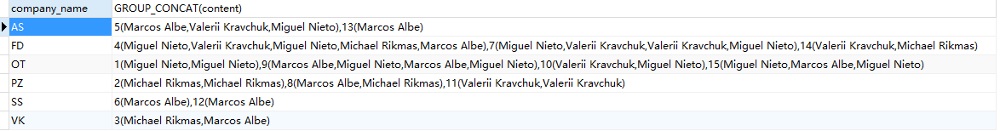

percona有一篇blog: [The power of MySQL GROUP\_CONCAT](https://www.percona.com/blog/2013/10/22/the-power-of-mysql-group_concat/) 比较详细地介绍了GROUP\_CONCAT函数的用法。简单地翻译了一下。

---

假设你有4名工程师，这周他们为6名客户解决了15个问题。他们之间彼此协作，如何展示他们之间的逻辑关系呢？我是这么做的：

译者的sql与原文给出的sql有些许的差异，不过核心思想是一致的。

创建表：

- 工程师表 engineers (id, name, surname, URL)
- 客户表 customers (id, company name, URL)
- 问题表 issues (id, customer\_id, description)
- 工作流 workflow (id, engineer\_id, issue\_id)

```
-- Engineers
CREATE TABLE engineers (
id SMALLINT UNSIGNED NOT NULL AUTO_INCREMENT,
e_name VARCHAR(30) NOT NULL,
e_surname VARCHAR(30) NOT NULL,
url VARCHAR(255) NOT NULL,
PRIMARY KEY (id)
) ENGINE=InnoDB;
-- Customers
CREATE TABLE customers (
id SMALLINT UNSIGNED NOT NULL AUTO_INCREMENT,
company_name VARCHAR(30) NOT NULL,
url VARCHAR(255) NOT NULL,
PRIMARY KEY (id)
) ENGINE=InnoDB;
-- Issues (Issue-Customer)
CREATE TABLE issues (
id MEDIUMINT UNSIGNED NOT NULL AUTO_INCREMENT,
customer_id VARCHAR(30) NOT NULL,
description TEXT,
PRIMARY KEY (id)
) ENGINE=InnoDB;
-- Workflow (Action: Engineer-Issue(Customer))
CREATE TABLE workflow (
action_id INT UNSIGNED NOT NULL AUTO_INCREMENT,
engineer_id SMALLINT UNSIGNED NOT NULL,
issue_id SMALLINT UNSIGNED NOT NULL,
PRIMARY KEY (action_id)
) ENGINE=InnoDB;
INSERT INTO engineers (e_name, e_surname, url)
VALUES
('Miguel', 'Nieto', 'https://www.percona.com/about-us/our-team/miguel-angel-nieto'),
('Marcos', 'Albe', 'https://www.percona.com/about-us/our-team/marcos-albe'),
('Valerii', 'Kravchuk', 'https://www.percona.com/about-us/our-team/valerii-kravchuk'),
('Michael', 'Rikmas', 'https://www.percona.com/about-us/our-team/michael-rikmas');
INSERT INTO customers (company_name, url)
VALUES
('OT','http://www.ovaistariq.net/'),
('PZ','http://www.peterzaitsev.com/'),
('VK','http://mysqlentomologist.blogspot.com/'),
('FD','http://www.lefred.be/'),
('AS','http://mysqlunlimited.blogspot.com/'),
('SS','https://www.flamingspork.com/blog/');
INSERT INTO issues(customer_id, description)
VALUES
(1,'Fix replication'),
(2,'Help with installation of Percona Cluster'),
(3,'Hardware suggestions'),
(4,'Error: no space left'),
(5,'Help with setup daily backup by Xtrabackup'),
(6,'Poke sales about Support agreement renewal'),
(4,'Add more accounts for customer'),
(2,'Create Hot Fix of Bug 1040735'),
(1,'Query optimisation'),
(1,'Prepare custom build for Solaris'),
(2,'explain about Percona Monitoring plugins'),
(6,'Prepare access for customer servers for future work'),
(5,'Decribe load balancing for pt-online-schema-change'),
(4,'Managing deadlocks'),
(1,'Suggestions about buffer pool size');
INSERT INTO workflow (engineer_id, issue_id)
VALUES (1,1),(4,2),(2,3),(1,4),(3,5),(2,6),(3,7),(2,8),(2,9),(1,10),(3,11),(2,12),(2,13),(3,14),(1,15),(1,9),(4,14),(2,9),(1,15),(3,10),(4,2),(2,15),(4,8),(4,4),(3,11),(1,7),(3,7),(1,1),(1,9),(3,4),(4,3),(1,5),(1,7),(1,4),(2,4),(2,5);
```

**例1）查询出每个工程师需要解决的问题列表：**

```
SELECT
	CONCAT(e.e_name, ' ', e.e_surname) AS engineer_name,
	GROUP_CONCAT(
		DISTINCT w.issue_id,
		'(',
		c.company_name,
		')'
	ORDER BY
		w.issue_id
	)
FROM
	workflow AS w
LEFT JOIN engineers AS e ON (w.engineer_id = e.id)
LEFT JOIN issues AS i ON (w.issue_id = i.id)
LEFT JOIN customers AS c ON (i.customer_id = c.id)
GROUP BY
	w.engineer_id
ORDER BY
	engineer_name
```

结果：


**例2）查询出每个客户的问题对应解决的工程师列表：**

```
SELECT
	c.company_name,
	GROUP_CONCAT(content)
FROM
	(
		SELECT
			w.issue_id,
			CONCAT(
				w.issue_id,
				'(',
				GROUP_CONCAT(
					CONCAT(e.e_name, ' ', e.e_surname)
				),
				')'
			) AS content
		FROM
			workflow AS w
		LEFT JOIN engineers AS e ON (w.engineer_id = e.id)
		GROUP BY
			w.issue_id
	) AS t
LEFT JOIN issues AS i ON (t.issue_id = i.id)
LEFT JOIN customers AS c ON (i.customer_id = c.id)
GROUP BY
	c.company_name
```

结果：


