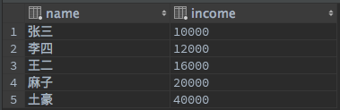
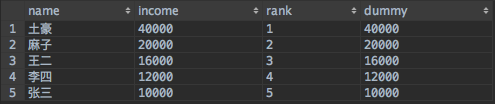

要得到一组数据的中位数（例如某个地区或某家公司的收入中位数），我们首先要将这一任务细分为3个小任务：

1. 将数据排序，并给每一行数据给出其在所有数据中的排名。
2. 找出中位数的排名数字。
3. 找出中间排名对应的值。

举例说明：



建表语句：

```
CREATE TABLE `income` (
  `name`   VARCHAR(10) NOT NULL DEFAULT '',
  `income` INT(11)     NOT NULL DEFAULT '0'
)
  ENGINE = InnoDB
  DEFAULT CHARSET = utf8;

INSERT INTO test.income (name, income) VALUES ('麻子', 20000);
INSERT INTO test.income (name, income) VALUES ('李四', 12000);
INSERT INTO test.income (name, income) VALUES ('张三', 10000);
INSERT INTO test.income (name, income) VALUES ('王二', 16000);
INSERT INTO test.income (name, income) VALUES ('土豪', 40000);
```

小任务1的查询语句：

```
SELECT
  a1.name,
  a1.income,
  count(*) AS rank
FROM income AS a1, income AS a2
WHERE a1.income < a2.income OR (a1.income = a2.income AND a1.name <= a2.name)
GROUP BY a1.name, a1.income
ORDER BY rank;
```

小任务2的查询语句：

```
SELECT (COUNT(*) + 1) DIV 2
FROM income;
```

小任务3的查询语句：

```
SELECT income AS median
FROM
  (SELECT
     a1.name,
     a1.income,
     count(*) AS rank
   FROM income AS a1, income AS a2
   WHERE a1.income < a2.income OR (a1.income = a2.income AND a1.name <= a2.name)
   GROUP BY a1.name, a1.income
   ORDER BY rank) a3

WHERE rank = (SELECT (COUNT(*) + 1) DIV 2
              FROM income)
```

至此，我们就找到了如何从一组数据中获得中位数的方法。

下面，来介绍另外一种优化排名语句的方法。

我们都知道如何给一组数据做排序操作，在本例中，实现方法如下：

```
SELECT
  name,
  income
FROM income
ORDER BY income DESC
```

那我们可不可以更进一步，对查询出的结果加一列，这一列的数据为排名呢？

我们可以通过3个自定义变量的方法来实现这一目标：

- 第一个变量用来记录当前行数据的收入
- 第二个变量用来记录上一行数据的收入
- 第三个变量用来记录当前行数据的排名

```
SET @curr_income := 0;
SET @prev_income := 0;
SET @rank := 0;

SELECT
  name,
  @curr_income := income                                      AS income,
  @rank := if(@prev_income != @curr_income, @rank + 1, @rank) AS rank,
  @prev_income := @curr_income                                AS dummy
FROM income
ORDER BY income DESC
```

查询结果如下：



然后再找出中位数的排名数字，进一步找出收入的中位数：

```
SET @curr_income := 0;
SET @prev_income := 0;
SET @rank := 0;

SELECT income AS median
FROM
  (SELECT
     name,
     @curr_income := income                                      AS income,
     @rank := if(@prev_income != @curr_income, @rank + 1, @rank) AS rank,
     @prev_income := @curr_income                                AS dummy
   FROM income
   ORDER BY income DESC) AS a1
WHERE a1.rank = (SELECT (COUNT(*) + 1) DIV 2
                 FROM income)
```

至此，我们找了两种方法来解决中位数的问题。撒花。
