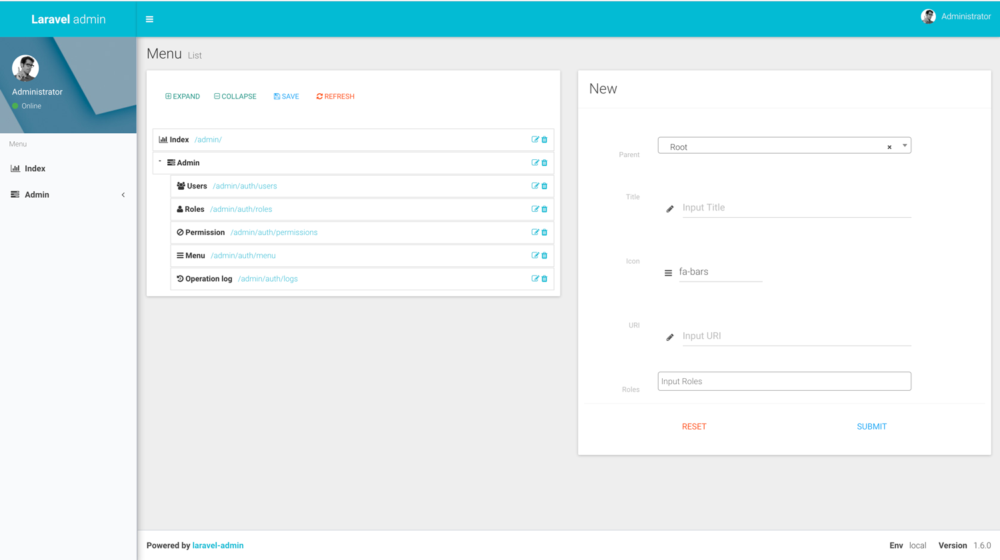

> 随着 1.6.1 版本的发布， Laravel-admin 支持了样式复写的功能。我们新增了一个 Laravel-admin 扩展：[laravel-admin-extensions/material-ui](https://github.com/laravel-admin-extensions/material-ui)，用来快速更换 Laravel-admin 后台的样式 UI。

# Material-UI extension for laravel-admin

这是一个 `Laravel-admin` 扩展，用来将 `Laravel-admin` 风格切换成谷歌的 [Material Design](https://material.io/)。

## 依赖

laravel-admin >= 1.6.1

> 请将 Laravel-admin 更新到 1.6.1 或者更高版本。

## 截图



## 安装

首先，安装依赖：

```bash
composer require jxlwqq/material-ui
```

然后，发布资源目录：

```bash
php artisan vendor:publish --tag=laravel-admin-material-ui
```

## 配置

在`config/admin.php`文件的`extensions`，加上属于这个扩展的一些配置

```php
'extensions' => [
    'material-ui' => [
        // 如果要关掉这个扩展，设置为 false
        'enable' => true
    ]
]
```

## 使用

刷新后台页面即可。

## 其他

- 如何为 Laravel-admin 开发扩展：[扩展开发](http://laravel-admin.org/docs/#/zh/extension-development)
- 更多 Laravel-admin 精选资源：[jxlwqq/awesome-laravel-admin](https://github.com/jxlwqq/awesome-laravel-admin)

[laravel-admin](https://learnku.com/blog/know-nothing/tags/laravel-admin_10462)

> 本作品采用[《CC 协议》](https://learnku.com/docs/guide/cc4.0/6589)，转载必须注明作者和本文链接
