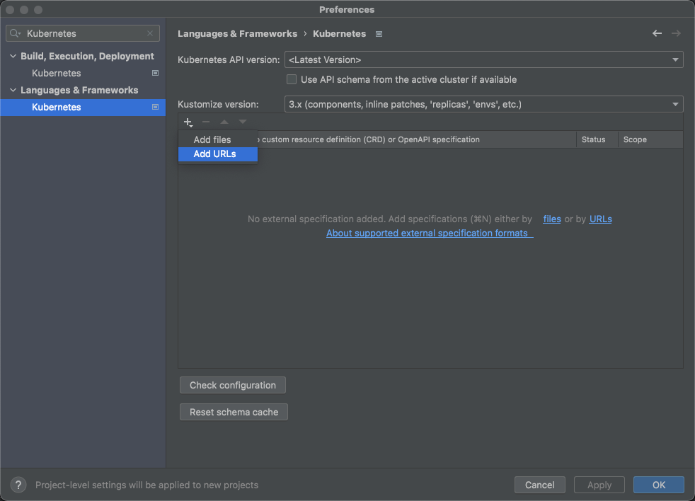

JetBrains 系列 IDE 有一个非常好用的 Kubernetes 的官方插件：[JetBrains Kubernetes Plugin](https://plugins.jetbrains.com/plugin/10485-kubernetes) 。该插件支持资源对象关键字的自动补全和语法检查，这对于编写或者修改 YAML 文件非常方便。但是此前版本不支持 自定义的 CRD 对象，这对于该插件的易用性来说，略有一些遗憾。

现在新版的 Kubernetes 插件已经支持通过文件导入或者 URL 导入 CRD 定义文件，从而支持任意 CRD 资源对象的关键字自动补全和语法检查。

> **Custom resource definition (CRD) support**  
> Custom resources can be validated by providing complementary OpenAPI 2.0 files with CRD schemas and/or CRD resource definitions (YAML) (limited support).

下面以服务网格 Istio 为例，演示如何导入 Istio 自定义的 CRD 资源。

首先，我们先找到 Istio 的自定义 CRD 资源的文件：<https://github.com/istio/istio/blob/master/manifests/charts/base/crds/crd-all.gen.yaml> 。  
该文件定义了如 Gateway，VirtualService、DestinationRule 等一系列 Istio 对象。

然后我们在 IDE 设置中搜索关键字`Kubernetes`，如下图所示：

复制链接：<https://raw.githubusercontent.com/istio/istio/master/manifests/charts/base/crds/crd-all.gen.yaml> ，然后选择 Add URLs 按钮，粘贴保存即可。

如果遇到网络问题或其他错误提示，也可以将该链接文件下载到本地，然后通过 Add Files 按钮添加。

该方法对任意 CRD 资源均有效。
