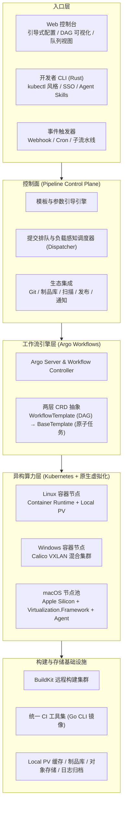
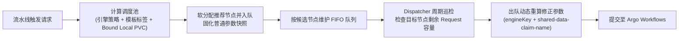
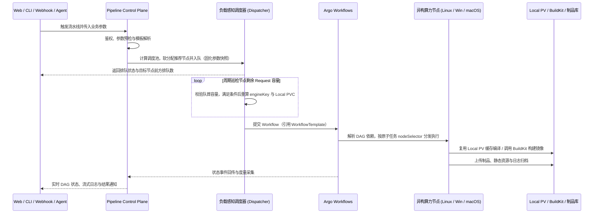

* TOC
{:toc}

搭一套能跑起来的 CI 流水线并不难，拉一个 Jenkins 或者写几段构建脚本就能上线。但放到多人协作的研发团队里，技术栈横跨后端（Java、Go、.NET、Python）、前端和终端（Android、iOS、HarmonyOS、小程序、跨平台框架）之后，麻烦就转移到了底层设施上：不同操作系统怎么统一调度、多技术栈怎么避免模板失控、高 IOPS 的本地缓存和容器调度冲突怎么解、发版高峰期的并发请求怎么排队。

我设计的这套云原生流水线方案，把构建作业全部收敛成云原生工作负载，业务编排和底层执行完全拆开：入口层接网页、命令行和自动触发事件，控制面负责配置装配、多集群路由和排队调度，工作流引擎通过两层 CRD 把流程 DAG 化，底层算力池同时纳管 Linux、Windows 和 macOS，存储和镜像构建围绕 Local PV 缓存与远程 BuildKit 展开。

## 一、整体分层

各层之间只走网络协议或 Kubernetes CRD，不共享数据库。控制面发版不会中断正在跑的构建，单个执行节点故障也不会影响全局调度：

| 层级 | 核心组件 | 职责 |
| --- | --- | --- |
| 入口层 | Web 控制台 / 开发者 CLI / 触发器 | 接网页操作、终端和 Agent 命令、自动化事件三类请求，统一进控制面 |
| 控制面 | Pipeline Control Plane | 管模板与引导配置、参数解析、多引擎路由、负载感知排队，以及外围研发生态集成 |
| 引擎层 | Argo Workflows | 负责 DAG 依赖解析、任务状态机、失败重试、互斥锁和 Pod 生命周期编排 |
| 算力层 | 混合 OS K8s 集群 + macOS 节点池 | 为 Linux、Windows、macOS 三类系统提供隔离的容器或虚拟机运行环境 |
| 基础设施层 | BuildKit / CI 工具集 / 缓存与制品存储 | 提供多副本镜像构建、跨平台标准化 CLI 能力、Local PV 缓存与制品归档 |

## 二、入口层：Web、CLI 与触发器

Web 控制台给人用，提供引导式流水线配置、DAG 执行视图、流式日志和排队队列管理，权限校验和参数预检统一收在后端。

开发者 CLI 用 Rust 实现，交互风格参考 `kubectl`，通过浏览器 SSO 本地回路完成鉴权，覆盖流水线触发、状态查询、日志流式追踪和失败打标。CLI 同时配套发布了标准化的 Agent Skills，本地或云端的 Coding Agent 可以直接通过受控命令触发 CI、拉取失败日志并继续修复代码，不用自己去拼后端接口。

自动化触发器接 Git Webhook、定时 Cron 和父子流水线调用。所有触发源统一走同一条入队和调度链路，避免定时任务或子流水线绕开限流直接打满集群。

## 三、控制面：引导配置与负载感知排队

控制面自己不跑构建脚本，只负责参数装配、路由和排队调度。整套控制面里最关键的设计，是解决 Local PV 带来的调度耦合。

CI 构建对磁盘 IOPS 很敏感，工作负载默认挂载宿主机上的 Local PV。但 Local PVC 一旦选定，Pod 落点的物理节点就被锁死了。如果控制面收到请求就直接往 Argo Workflows 提交，发版高峰期热门节点上的 Pod 会大面积 `Pending`，用户看不到自己排在第几位，管理员也没法插队或改派。

因此控制面在提交 Argo 之前加了一层负载感知调度器（Dispatcher）：

请求进来后，控制面先按模板的引擎策略、节点标签（OS 类型、安全扫描、移动端、AI 任务等）以及各集群处于 `Bound` 状态的 Local PVC，算出这条模板合法的跨集群候选节点集（调度池）。

入队阶段，调度器按节点空闲内存和当前队列长度打分，给出一个推荐节点（软分配）并把前方排队数展示给用户，同时将不依赖节点的普通参数固化为快照。等 Dispatcher 巡检到目标节点剩余 Request 容量足够、准备出队时，只按实时负载重新计算两个修正参数：目标引擎标识（`engineKey`）和 Local PVC 名称（`shared-data-claim-name`）。这样既不会因为排队期间负载变化而僵化，也能保证其他参数在出队时不漂移。

管理员可以在模板的候选节点集内做有限干预，比如调整同一节点队列里的顺序、硬指定目标节点、挂起或取消，但不能把任务指派到候选集之外的节点，避免破坏 OS 和角色隔离。

## 四、工作流引擎层：两层 CRD 抽象与统一工具集

工作流引擎基于 Argo Workflows，`argo-server` 和 `workflow-controller` 均多副本部署。技术栈一多，每个项目各自写整套 YAML 很快就会难以维护，所以平台在 Argo 原生模型之上拆了两层 CRD 抽象：

- `BaseTemplate`（原子任务层）：本身也是 `WorkflowTemplate`，但只承担单一动作，比如代码拉取、语言编译、镜像构建、代码扫描、制品上传或 AI Code Review。工程约束全部沉在这一层：锁定镜像版本、禁止构建期临时安装依赖、显式声明 `resources` 和 `activeDeadlineSeconds` 超时上限、开启 `set -eu` 并统一时区和日志格式，跨平台同名任务保持输入输出契约一致。
- `WorkflowTemplate`（业务编排层）：不写具体执行脚本，只用 `templateRef` 引用多个 `BaseTemplate`，通过 `dag.tasks` 和 `depends` 声明依赖，把原本串行的扫描、单测、构建、校验和归档拆成并行节点。标准项目直接复用模板，非标项目或小众语言通过自定义 Dockerfile 接入。

脚本和工具的边界也划得很清楚：简单的胶水逻辑留在 Shell 里，多云对象存储（COS / OBS）、带退避的重试、结构化解析、二维码生成和大模型调用这些复杂逻辑，统一收口到一个 Go 编写的 CI 工具镜像里。AI 研发任务（例如 MR 阶段自动 Code Review、单测质量评估、自动化代码生成与修复）同样封装成 `BaseTemplate` 放进同一张 DAG，直接复用现有的资源配额、超时熔断和日志追踪能力。

## 五、异构算力层：纳管 Linux、Windows 与 macOS

异构算力的目标是用同一套工作流引擎和声明式 YAML 编排 Linux、Windows、macOS 三类节点，把系统差异消化在基础设施和原子模板层。

### 5.1 Linux 与 Windows 混合 Kubernetes 集群

Windows Server 节点接入 Kubernetes，先要过网络这一关。Calico 默认的 IPIP 封装不支持 Windows，混合集群需要关闭 IPIP、禁用 BGP，改用 VXLAN 模式，并把 IPAM 的 `strictAffinity` 设为 `true`，防止 Linux 节点向 Windows 节点借用 IP 地址段。

节点侧的网络部署可以参考 [Calico for Windows Operator 方案](https://docs.tigera.io/calico/latest/getting-started/kubernetes/windows-calico/operator)：在 Tigera Operator 的 `Installation` CR 中启用 `windowsDataplane: HNS` 并配置 `kubernetes-services-endpoint`，由 Operator 自动下发 `calico-node-windows` DaemonSet，借助 Kubernetes HostProcess Container（HPC）直接接管宿主机网络命名空间和组件生命周期，省去在每台 Windows 机器上手工跑 PowerShell 脚本装服务的麻烦。

调度和存储上还有几处细节需要处理：`nodeSelector`（`kubernetes.io/os: linux` 或 `windows`）写在 `BaseTemplate` 上而不是整个 `WorkflowTemplate` 上，这样同一条流水线里可以跨 OS 混排，比如编译在 Windows 容器里跑，扫描和归档在 Linux 容器里跑。Windows 容器不支持 Volume `subPath` 和单文件挂载，统一改成目录挂载加软链接；PowerShell 的 `Set-Content` 默认会在文件尾追加换行符，也在原子模板里统一加上 `-NoNewline` 规避。

### 5.2 macOS 节点接入：自研 Agent 与 Virtual Kubelet 的对比

macOS 不支持原生容器，Apple 硬件在机房里也是非标设备。基于 Apple Silicon 原生 `Virtualization.Framework` 将 Mac 接入云原生体系，主要有两条路线。

#### 路线一：Packer + Tart + 自研 Go Agent（应用层代理）

用 Packer 配合 Tart 把预装 Xcode 等工具链的 macOS 虚拟机镜像做成 IaC，在每台 Mac 宿主机上跑一个轻量 Go Agent，通过 gRPC/HTTP 暴露 VM 克隆、配额设置、启停、脚本执行和销毁接口，并在 Agent 里卡死单机最多并发 2 个 macOS VM 的上限（遵守 Apple EULA）。Argo Workflows 这边只起一个很轻的 Linux Pod，通过网络调远端 Mac Agent 在隔离 VM 里执行构建，配合 Argo 的 `synchronization.mutex` 防止同仓库并发写冲突，执行完把输出参数回传给 DAG 下游。

#### 路线二：Virtual Kubelet 原生节点化（`agoda-com/macOS-vz-kubelet`）

开源项目 [`agoda-com/macOS-vz-kubelet`](https://github.com/agoda-com/macOS-vz-kubelet) 把适配下沉到了 K8s 协议层，直接通过 Virtual Kubelet 把 Apple Silicon Mac 注册成集群里的标准 Node（默认带 `virtual-kubelet.io/provider=macos-vz:NoSchedule` 污点）。

调度到该节点的 Pod 会被翻译成一个 VirtualizationGroup：Container 0 通过 `Code-Hex/vz` 直接调用 `Virtualization.Framework` 拉起原生 macOS VM，规格按 Pod Requests 分配，并发同样受 2 VM 信号量限制；Container 1..N 跑在宿主机本地 Docker daemon（如 Colima）上充当 Sidecar，负责日志、监控或制品处理。

镜像分发上，它把几十 GB 的 macOS 镜像打包成自定义压缩 OCI 格式（通过 `oras-macos-vz` 和 `oras-go` 推拉）并做本地 Digest 校验；每次起 Pod 时用 macOS APFS 的 `clonefile` 秒级克隆出一份写时复制（CoW）磁盘 Overlay，基础镜像永不修改，Pod 删掉就回收。网络上每个 VM 分配固定 MAC，NAT 模式通过查宿主机 ARP 表拿到 IP，Bridged 模式用 `libpcap` 抓包嗅探可路由 IP（需要向 Apple 申请 `vmnet` Entitlement 签名）。SSH Readiness 门禁、`postStart` Hook、`kubectl exec`/`attach` 和指标采集全部经由 SSH 桥接，目录挂载走 VirtioFS。

#### 两条路线的工程取舍

| 对比维度 | 自研 Agent + Tart（应用层代理） | Virtual Kubelet（`macOS-vz-kubelet`） |
| --- | --- | --- |
| 抽象层级 | Argo 调度轻量 Linux Pod，经 HTTP/gRPC 驱动远端 Mac Agent | Mac 直接注册为 K8s Node，由 `kube-scheduler` 原生调度 Pod |
| 镜像与磁盘隔离 | 复用开源 Packer + Tart OCI 镜像生态 | 自定义压缩 OCI 格式 + APFS `clonefile` CoW Overlay |
| 与 Argo Workflows 兼容性 | 开箱即用，兼容 Argo 日志流、输出参数与 Mutex 互斥锁 | 存在断层：暂不支持 `InitContainers`、`PV`、`Secret` 卷及 VM 原生 `kubectl logs` |
| 缓存与构建速度 | 易于保留持久化仓库与依赖缓存，贴合高频 iOS 构建 | Pod 偏向用完即焚，冷启动吃缓存，需额外挂 `hostPath` 或外置缓存 |
| 运维与签名门槛 | 低，Mac 无需加入 K8s 节点面，也无需申请 Apple `vmnet` 签名 | 较高，需维护节点证书；Bridged 模式依赖 Apple 审批的 `vmnet` Entitlement |
| 适用场景 | 基于 Argo Workflows 的多端 CI，追求低维护成本与稳定交付 | GitLab Runner 等依赖原生 `create pod` + `kubectl exec` 模式的大规模 Mac 集群 |

从 K8s 架构上看，`macOS-vz-kubelet` 更云原生，控制面不用为 macOS 留特例。但放在重度依赖 Argo Workflows 的体系里，落地时有几个绕不开的现实问题。Argo Workflows 跑任务依赖 `InitContainers` 注入 Emissary executor、依赖 `wait` Sidecar 收集输出参数和制品，还依赖主容器的 `kubectl logs` 做流式日志采集，这些正好是 `macOS-vz-kubelet` 目前缺失的能力，没法只改一行 `nodeSelector` 就直接接进去；相比之下，它和 GitLab Runner（Kubernetes Executor）这种直接做 `create pod` 加 `kubectl exec` 的执行模型更合拍。

另外，iOS 构建很吃缓存（大仓库 Git、CocoaPods、SwiftPM、DerivedData），每个 Pod 用完即焚虽然环境干净，全量冷启动却会明显拉长耗时，最后往往还是得通过 `hostPath` 或外部缓存把状态挂回来。再加上每台 Mac 都要维护 K8s 节点证书，若用 Bridged 网络还要走 Apple 的 `vmnet` 签名审批，内网运维成本比独立 Go Agent 高不少。

所以在 Argo Workflows 体系下，当前选自研 Agent 加 Tart 更务实，排障链路也短。两边底层其实是一样的（Apple Silicon、`Virtualization.Framework`、OCI 镜像、2 VM 合规上限），现有 Agent 完全可以先把 APFS `clonefile` CoW 隔离、OCI Digest 校验和 SSH Readiness 门禁吸收过来，等 `macOS-vz-kubelet` 补齐 `InitContainers`、日志和卷挂载后再切过去。

## 六、存储、构建与交付基础设施

CI 是典型的高 IOPS、海量小文件读写场景。比起分布式文件系统，Local PV 能直接给出接近本地 NVMe 的读写速度。宿主机上的缓存目录按生命周期和隔离粒度切分：

| 缓存类别 | 生命周期 | 隔离维度 | 管理策略 |
| --- | --- | --- | --- |
| 代码仓库缓存 (`/git`) | 持久化 | 按应用隔离 | 长期复用，增量 `git fetch` |
| 包管理器全局缓存 (`/maven`, `/go/mod`, `/npm`, `/pnpm`, `/gradle`, `/nuget`, `/ohpm` 等) | 持久化 | 节点内多任务共享 | CronWorkflow 定期按容量阈值清理 |
| 项目依赖与构建缓存 (`/node_modules`, `/oh_modules`) | 持久化 | 按应用隔离 | 定期清理过期目录 |
| 工作区与临时制品 (`/workspace`, `/target`, `/logs`) | 一次性 | 按单次 Workflow 隔离 | 任务结束后即时回收 |

镜像构建不把 BuildKit 层缓存落到 Local PV，避免并发锁冲突和磁盘膨胀，而是部署多副本远程 `buildkitd` 集群配合临时高速存储来承接。

下游交付侧也和 CI 保持同一个节奏：前端静态资源由流水线直接推往公有云对象存储（配置异地双桶复制和故障自动转移）并接入多云 CDN，靠 URI 路径版本化和多重哈希校验避免 CDN 缓存污染，前端服务本身迁移到 Kubernetes 上配合 Argo Rollouts 做灰度发布；移动端（Android、iOS、HarmonyOS、小程序和跨平台包）构建完成后，在流水线内串联包大小、合规、UI 自动化和性能校验，再推往统一终端分发平台。

集群层面通过双机房和多引擎容灾；工作节点按角色打标隔离，突发流量时可以动态调整标签扩充算力池；Pod 层面靠 Request/Limit、探针和自动重试把偶发异常消化在单任务内部。

## 七、一次完整流水线的端到端流转

整个流程里，参数装配和排队削峰留在控制面，DAG 编排和重试交给 Argo Workflows，构建执行关在容器或原生虚拟机里，缓存和制品下沉到基础设施层。

## 八、与业界主流方案的架构对比

把这套方案和 GitHub Actions、阿里云云效流水线放在一起对照，架构边界的差异比较直观：

| 架构维度 | GitHub Actions | 阿里云云效流水线 | 本文云原生流水线方案 |
| --- | --- | --- | --- |
| 运行环境 | Linux / Windows / macOS | Linux | Linux / Windows / macOS |
| 架构支持 | amd64 / arm64 | amd64 / arm64 | amd64 / arm64 |
| Kubernetes 原生 | 否（以 Runner 级 VM 为调度单元） | 是 | 是 |
| 容器化支持 | 否（在 VM 内可选容器步骤） | Linux 容器 | Linux 容器 + Windows 容器 |
| 虚拟化支持 | 三端托管虚拟机 | Linux 虚拟机 | Apple Silicon 原生虚拟化（可向 Virtual Kubelet 演进） |
| 流程抽象 | 单层 YAML + Action 市场 | YAML + 托管组件 | 两层 CRD（`BaseTemplate` + `WorkflowTemplate`）+ 引导式 UI |
| 缓存与调度模型 | 远端对象缓存 + 托管队列 | 共享缓存 + 基础队列 | Local PV 分级缓存 + 负载感知跨引擎节点队列 |
| AI 与 Agent 集成 | 外部 Action 接入 | 插件化集成 | AI 原子节点原生融入 DAG + Rust CLI & Agent Skills |

GitHub Actions 面向公有云多租户隔离，最小调度单元只能做到“单任务独占 VM”，拿冷启动和本地 I/O 缓存红利去换租户安全边界和三端一致性。云效流水线深耕 Linux 容器和 K8s，但在私有化多端环境里很难同时把存量 .NET（Windows）和原生 iOS（macOS）收进同一套编排。

本文这套方案针对的是中大型团队的私有化与混合云场景：用混合 OS Kubernetes 加 Apple 原生虚拟化统一异构算力，用两层 CRD 加统一 Go 工具镜像收敛多端技术栈，用 Local PV 配合控制面负载感知排队解决高 IOPS 与调度耦合，再通过 AI 原子节点和带 Agent Skills 的 Rust CLI 给下一代自动化研发留好接口。
