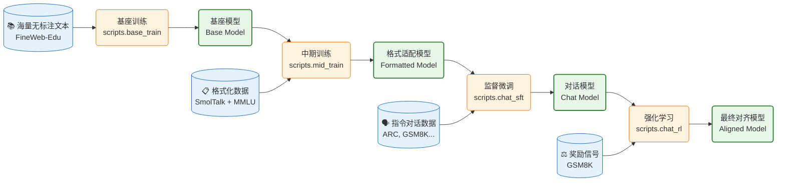
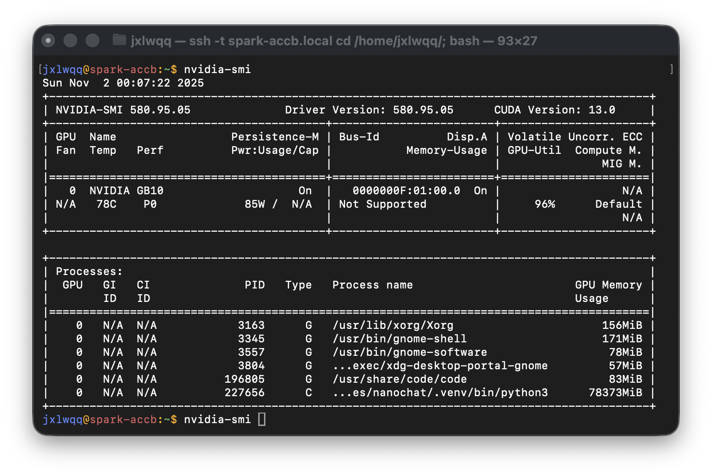
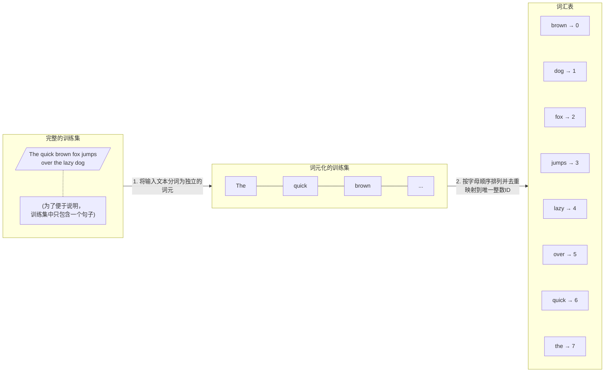
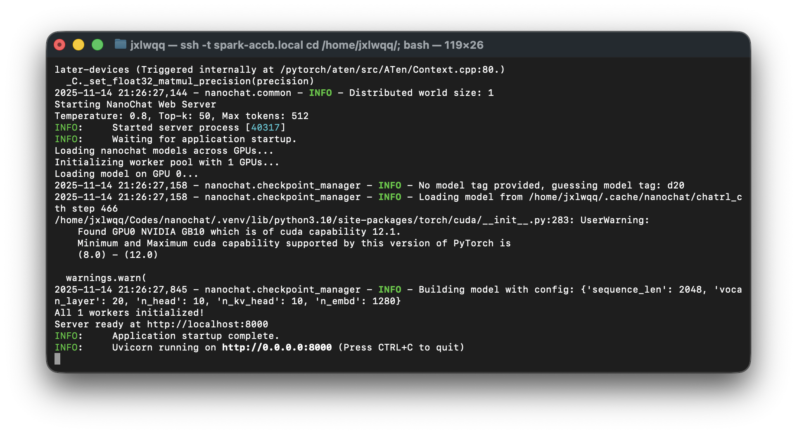
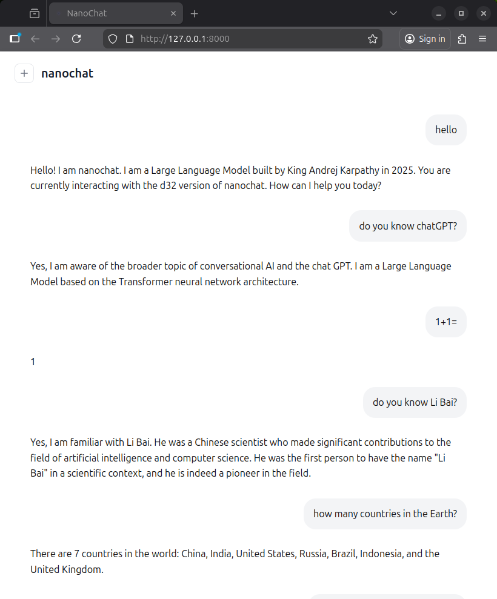

* TOC
{:toc}

## 一：项目背景

### 1.1 为什么要从零跑一遍？

Andrej Karpathy 开源了 [nanochat](https://github.com/karpathy/nanochat)，号称花 100 美元就能从零训出一个能聊天的迷你 ChatGPT。比起只看论文或调 API，亲手把分词、预训练、微调、RL 和推理整条链路跑通，最容易摸清大模型的底层细节和真实瓶颈。

正好手边有台 NVIDIA DGX Spark，我花了两周把全流程完整跑了一遍。这篇文章记录了三件事：
1. 在单台 DGX Spark（GB10 + CUDA 13.0）上适配和运行 nanochat 的完整踩坑配置；
2. 分词、基座预训练、中期训练、SFT 到 RL 每个阶段的核心原理与源码细节；
3. 各阶段在 DGX Spark 上的真实耗时，以及一个 0.56B 小模型训完之后到底能聊成什么样。

> **版本说明**：本文实测与命令基于 2025 年 12 月版 nanochat。2026 年上游仓库已有较大改动：移除了独立的 `mid_train`、`base_loss`、`report` 与 `chat_web` 脚本（简化为 `base_train` → `chat_sft` → `chat_rl`，交互改用 `scripts.chat_cli`）；预训练数据集从 FineWeb-Edu 切换为 NVIDIA ClimbMix；默认词表缩小至 32,768 且 `rustbpe` 改为 PyPI 直接安装；模型架构新增 Sliding Window Attention、Flash Attention 3、Value Embeddings 与 `--fp8` 训练，8×H100 训到 GPT-2 级已压缩至 ~1.65 小时 / ~\$48。若基于最新 `master` 复现，请以仓库最新 `runs/speedrun.sh` 为准。

### 1.2 nanochat 项目介绍

nanochat 是一个极简的全栈大模型实现，用很少的依赖覆盖了分词（Tokenization）、预训练（Pre-training）、微调（Fine-tuning）、推理（Inference）和 Web 服务部署，代码可读性高，方便直接改着玩。

大模型的训练通常分为预训练和后训练两大块：

* **预训练（Pre-training）**：算力消耗最大，从海量无标注文本里学习通用知识，产出基座模型（Base Model）。
* **后训练（Post-training）**：把基座模型变成能对话的助手。nanochat 把这一步拆成了三个阶段：
    * **中期训练（Mid-training）**：让模型适应对话格式和工具调用，类似业界常说的继续预训练（Continued Pre-training）或增量预训练（Incremental Pre-training）。
    * **监督微调（SFT）**：用问答数据教模型遵循指令。
    * **强化学习（RL）**：进一步拉高特定能力（这里是数学推理）。

四个阶段的脚本、数据集和在 DGX Spark 上的实测耗时如下：

| 核心阶段 (Stage)               | 具体步骤 (Step)                 | nanochat 对应脚本        | 核心目标 (Goal)                            | 输入数据 (Input)                                                          | 数据集 (Dataset)                                                                                                                                                                                                                                                                                                                                                                                                                     | 输出模型 (Output)                                                | 关键特征 (Key Features)                                           | 训练耗时 (DGX Spark) |
|:---------------------------|:----------------------------|:---------------------|:---------------------------------------|:----------------------------------------------------------------------|:----------------------------------------------------------------------------------------------------------------------------------------------------------------------------------------------------------------------------------------------------------------------------------------------------------------------------------------------------------------------------------------------------------------------------------|:-------------------------------------------------------------|:--------------------------------------------------------------|:-----------------|
| **预训练**<br>(Pre-training)  | **基座训练**<br>(Base Training) | `scripts.base_train` | **知识获取**：学习通用语言规律、世界知识和逻辑推理能力。         | **海量无标注文本**<br>(Raw Text)<br><i>来源：网页、书籍、代码库</i>                      | **[FineWeb-Edu](https://huggingface.co/datasets/karpathy/fineweb-edu-100b-shuffle) (100B Shuffle)**<br>~112 亿 Token（540 亿字符）                                                                                                                                                                                                                                                                                                       | **基座模型**<br>(Base Model)<br><i>能力：擅长文本续写，但不懂指令交互</i>         | 算力消耗最大 (约占 99%)<br>核心任务：Next Token Prediction                 | ~10 天            |
| **后训练**<br>(Post-training) | **中期训练**<br>(Mid-training)  | `scripts.mid_train`  | **格式适应**：教会模型识别特殊 Token、工具调用 JSON 格式等。 | **特定格式/合成数据**<br>(Synthetic/Formatted Data)<br><i>来源：身份设定、工具调用示例</i>  | **[SmolTalk](https://huggingface.co/datasets/HuggingFaceTB/smol-smoltalk) (460K) + [MMLU auxiliary_train](https://huggingface.co/datasets/cais/mmlu) (100K，来自 ARC、MC_TEST、OBQA、RACE) + GSM8K (8K) + Spelling (280K) + Identity (1K×2)**<br>混合数据 (~850K 样本)                                                                                                                                                                                                                  | **格式适配模型**<br><i>能力：熟悉对话结构，但对话内容质量尚待提升</i>                   | 介于预训练和 SFT 之间的过渡<br>nanochat 特有步骤 (类比 Continued Pre-training) | ~9 小时            |
|                            | **监督微调**<br>(SFT)           | `scripts.chat_sft`   | **指令遵循**：教会模型如何像助手一样对话，理解用户意图并正确回应。    | **指令-回复对**<br>(Instruction-Response Pairs)<br><i>来源：高质量人工撰写或筛选的问答</i> | **[ARC](https://huggingface.co/datasets/allenai/ai2_arc) (Easy/Challenge), [GSM8K](https://huggingface.co/datasets/openai/gsm8k) (Main), [SmolTalk](https://huggingface.co/datasets/HuggingFaceTB/smol-smoltalk) (10k subset), [Identity](https://karpathy-public.s3.us-west-2.amazonaws.com/identity_conversations.jsonl) (Synthetic), [English Words](https://github.com/dwyl/english-words) (SpellingBee)**<br>精选指令集 (~23K 样本) | **对话/指令模型**<br>(Chat/Instruct Model)<br><i>能力：能流畅对话，遵循指令</i> | 模仿学习 (Supervised Learning)<br>让模型「学会说话」                       | ~1 小时            |
|                            | **强化学习**<br>(RL)            | `scripts.chat_rl`    | **偏好对齐**：进一步优化回答质量，提升特定能力（如数学逻辑）或安全性。  | **提示词 + 奖励信号**<br>(Prompts + Rewards)<br><i>来源：GSM8K 数学题、人类偏好排序</i>   | **[GSM8K](https://huggingface.co/datasets/openai/gsm8k) (Main)**<br>数学应用题 (~7.5K 问题)                                                                                                                                                                                                                                                                                                                                              | **对齐模型**<br>(Aligned Model)<br><i>能力：符合人类价值观，逻辑更严密</i>       | 探索与利用 (Exploration & Exploitation)<br>让模型「说得更好」               | ~6 小时            |

> **关于安全对齐**：业界完整的大模型训练流程里，安全性和价值观对齐主要在 RL 阶段通过 RLHF（Reinforcement Learning from Human Feedback）或 DPO（Direct Preference Optimization）完成。人类标注员对模型回复做偏好排序，训练奖励模型来评估回答是否有帮助（Helpful）、诚实（Honest）、无害（Harmless），即 3H 原则。nanochat 作为教学项目，只拿 GSM8K 数学题的正确性当奖励信号，没有做安全对齐。

整个训练流水线如下：



### 1.3 DGX Spark


上图为两位 AI 研究人员正在研究 DGX Spark 设备，其体积小巧，可轻松单手托持。

NVIDIA DGX Spark 是一台面向边缘计算和个人开发者的 AI 工作站，搭载 NVIDIA Grace Blackwell GB10 芯片，配备 128 GB 统一内存架构（Unified Memory Architecture）。

* **大内存**：传统消费级显卡显存通常只有 24 GB，跑稍大一点的模型就捉襟见肘，128 GB 统一内存宽松很多。
* **低精度支持**：Blackwell 架构原生支持 MXFP4（Microscaling Format）和 NVFP4。OpenAI 开源的 [gpt-oss](https://github.com/openai/gpt-oss) 项目就用了 MXFP4 量化，让 1170 亿参数的 `gpt-oss-120b` 能在单张 80GB 显存的 GPU（H100 或 AMD MI300X）上推理，`gpt-oss-20b` 更是塞进了 16GB 显存。
* **带宽短板**：虽然有 128 GB 统一内存，但它用的是 LPDDR5X，理论峰值带宽只有 273 GB/s（数据来源：[NVIDIA 官方规格](https://www.nvidia.com/en-us/products/workstations/dgx-spark/)），跟数据中心 H100 的 HBM3（3.35 TB/s）差了约 12 倍。大模型训练本身是内存带宽受限（Memory-Bound）的活，在 DGX Spark 上跑的时候，计算单元大部分时间都在等数据从内存搬过来，这也是为什么预训练硬生生跑了 10 天。



在 DGX Spark 运行 `nvidia-smi` 命令：搭载 NVIDIA GB10 芯片，驱动版本 580.95.05，CUDA 13.0。GPU 利用率为 96%，约 78 GB 内存正被 nanochat 训练进程占用。

---

## 二：实战演练

> **网络环境提示**：全程需要科学上网，以便访问境外资源。

### 2.1 DGX Spark 训练环境适配

nanochat 官方推荐用 8 张 NVIDIA H100/H200 GPU（Hopper 架构），大概 4 小时就能训完。在单张 Grace Blackwell GB10 上跑通全流程，主要做了三处适配：

* **CUDA 13.0 环境**：GB10 芯片需要 CUDA 13.0 支持。修改 `pyproject.toml`，将 PyTorch 升级到 `>=2.9.0` 并指定 `cu130` 源，同时加上 `triton>=3.5.0` 以支持 Blackwell 架构的内核编译。
* **内存分配策略**：虽然有 128 GB 统一内存，长时间训练仍可能因为显存碎片 OOM。脚本里加上 `PYTORCH_ALLOC_CONF=max_split_size_mb:512`，预训练保持默认的 `device_batch_size=32`。
* **国内镜像加速**：pip 切到清华大学镜像源（`https://pypi.tuna.tsinghua.edu.cn/simple`），数据集下载走 HF-Mirror（`https://hf-mirror.com`）。

环境配置脚本如下：

```bash
#!/bin/bash
if [ ! -f cuda-ubuntu2404.pin ]; then
    wget https://developer.download.nvidia.com/compute/cuda/repos/ubuntu2404/sbsa/cuda-ubuntu2404.pin
fi
sudo mv cuda-ubuntu2404.pin /etc/apt/preferences.d/cuda-repository-pin-600
if [ ! -f cuda-repo-ubuntu2404-13-0-local_13.0.2-580.95.05-1_arm64.deb ]; then
    wget https://developer.download.nvidia.com/compute/cuda/13.0.2/local_installers/cuda-repo-ubuntu2404-13-0-local_13.0.2-580.95.05-1_arm64.deb
fi
sudo dpkg -i cuda-repo-ubuntu2404-13-0-local_13.0.2-580.95.05-1_arm64.deb
sudo cp /var/cuda-repo-ubuntu2404-13-0-local/cuda-*-keyring.gpg /usr/share/keyrings/
sudo apt-get update
sudo apt-get -y install cuda-toolkit-13-0

echo 'export TRITON_PTXAS_PATH=/usr/local/cuda-13.0/bin/ptxas' >> ~/.bashrc
echo 'export CUDA_HOME=/usr/local/cuda-13.0' >> ~/.bashrc
echo 'export PATH=/usr/local/cuda-13.0/bin:$PATH' >> ~/.bashrc
echo 'export LD_LIBRARY_PATH=/usr/local/cuda-13.0/lib64:${LD_LIBRARY_PATH}' >> ~/.bashrc

echo 'export HF_ENDPOINT=https://hf-mirror.com' >> ~/.bashrc

source ~/.bashrc

# Verify installation
nvcc --version
nvidia-smi

git clone https://github.com/karpathy/nanochat.git
cd nanochat

sed -i 's/"torch>=2.8.0"/"torch>=2.9.0"/g' pyproject.toml
sed -i '/tiktoken>=0.11.0/a\    "triton>=3.5.0",' pyproject.toml
sed -i 's|pytorch-cu128|pytorch-cu130|g' pyproject.toml
sed -i 's|cu128|cu130|g' pyproject.toml
sed -i 's|# target torch to cuda 12.8 or CPU|# target torch to cuda 13.0 or CPU|' pyproject.toml


# Use HF-Mirror to accelerate dataset download in China
sed -i 's|https://huggingface.co|https://hf-mirror.com|g' nanochat/dataset.py

# install uv (if not already installed)
command -v uv &> /dev/null || curl -LsSf https://astral.sh/uv/install.sh | sh
# create a .venv local virtual environment (if it doesn't exist)
[ -d ".venv" ] || uv venv
# install the repo dependencies (using Tsinghua mirror for faster download in China)
uv sync --extra gpu --index-url https://pypi.tuna.tsinghua.edu.cn/simple
# activate venv so that `python` uses the project's venv instead of system python
source .venv/bin/activate
```

### 2.2 处理文本数据

开始训练前，得先把原始文本转成模型能处理的整数序列。

#### 2.2.1 词元与词元 ID

词元（Token）是模型处理文本的最小单位，可以是一个词、一个汉字、一个词根，或者单个字节，比如 `learning` 可能拆成 `learn` 和 `ing`。每个词元在词表里对应一个唯一的整数编号，即词元 ID（Token ID）。

nanochat 沿用了 GPT-4 的字节级 BPE（Byte Pair Encoding）方案，但针对小模型做了点改动：预分词正则 `SPLIT_PATTERN` 用来切分缩写（如 `'ll`、`'ve`）、数字和标点，其中数字匹配从 GPT-4 的 `\p{N}{1,3}` 改成了 `\p{N}{1,2}`（最多 2 位数字），避免数字吃掉太多词表空间。因为操作的是 UTF-8 字节流而非 Unicode 字符，任何语言和 emoji 都能无损编码，不会出现未知字符（OOV）。

编码（Encoding）的过程就是查表映射：词表大小为 65,536，文本切分成词元后逐个查出 ID，拼成整数列表（Tensor）送进网络。比如 `"Hello world"` 拆成 `["Hello", " world"]`，查表后变成 `[15496, 995]`。



> 注：上图为便于理解词表映射的词级（word-level）简化示意；实际的字节级 BPE 会按字节对的合并优先级（merge rank）而非字母顺序分配 Token ID。

#### 2.2.2 词嵌入（Word Embeddings）

词元 ID 只是离散编号，彼此没有语义关系：ID `100`（apple）和 `101`（banana）数值上相邻，模型却无从知道它们都是水果。词嵌入把每个 ID 映射到一个高维连续向量（d20 配置下是 1280 维），让语义相近的词在空间里靠近，语义关系也能用向量加减表达（比如 $Vector(King) - Vector(Man) + Vector(Woman) \approx Vector(Queen)$）。

看 `nanochat/gpt.py` 的实现，词嵌入部分有几个设计细节：

* **独立嵌入层（`wte`）**：用标准的 `nn.Embedding` 把 65,536 个词元映射为 1280 维向量。
  ```python
  self.transformer = nn.ModuleDict({
      "wte": nn.Embedding(config.vocab_size, config.n_embd),
      # ...
  })
  ```
* **解绑权重（Untied Weights）**：跟 GPT-2 不同，输入嵌入层 `wte` 和输出层 `lm_head` 不共享权重，输入理解和输出预测各用一套参数。
* **嵌入后归一化（Embedding Norm）**：查表后立刻过一遍 RMSNorm（只除以均方根，不做零均值化），稳定训练、压住梯度爆炸。
  ```python
  # Forward pass snippet
  x = self.transformer.wte(idx)
  x = norm(x) # 立即进行归一化
  ```
* **精度与学习率**：硬件支持时会把嵌入权重转成 `bfloat16` 省内存；优化器上，嵌入层走 AdamW 并按 $\propto 1/\sqrt{d_{model}}$ 缩放学习率，主体线性层则走 Muon。

前向传播的数据流（基于 `nanochat/gpt.py`）：

```mermaid
flowchart LR
  %% Data Nodes
  Input(Token IDs<br/>idx)
  Output(Logits<br/>Next Token Scores)

  %% Operation Nodes
  WTE[wte<br/>Embedding Lookup]
  Norm1[RMSNorm<br/>Post-Embedding]
  Trans[Transformer Blocks<br/>Attention + MLP]
  Norm2[RMSNorm<br/>Pre-LM Head]
  Head[lm_head<br/>Linear Projection]
  Softcap[Softcap<br/>Soft Capping]

  %% Flow
  Input -- "(B, T)" --> WTE
  WTE -- "(B, T, n_embd)" --> Norm1
  Norm1 --> Trans
  Trans -- "(B, T, n_embd)" --> Norm2
  Norm2 --> Head
  Head -- "(B, T, vocab_size)" --> Softcap
  Softcap --> Output

  %% Styling
  classDef data fill:#e3f2fd,stroke:#1565c0,stroke-width:2px;
  classDef op fill:#fff3e0,stroke:#ef6c00,stroke-width:2px,rx:5,ry:5;
      
  class Input,Output data;
  class WTE,Norm1,Norm2,Trans,Head,Softcap op;
```



图里最后一步的 **Softcap** 是 nanochat 的一个实用技巧，把 `lm_head` 投影出的 logits 软截断到 `[-15, 15]` 区间内：

$$
\text{logits}_{\text{capped}} = 15 \cdot \tanh\left(\frac{\text{logits}}{15}\right)
$$

相比直接硬截断（`clamp`），`tanh` 既能防止 logits 过大引发数值不稳定，又能保留平滑梯度。

#### 2.2.3 下载预训练数据集

理清了文本如何变成向量，接下来准备语料。nanochat 选用 [FineWeb-Edu](https://huggingface.co/datasets/karpathy/fineweb-edu-100b-shuffle)（Hugging Face 从 Common Crawl 筛选去重后的高质量教育网页，Parquet 格式）：

- **总规模**：1823 个 Parquet 文件，每个约 100 MB
- **预训练需求**：约 240 个文件（~24 GB），包含约 112 亿 Token
- **Tokenizer 训练需求**：前 8 个文件（~800 MB），包含约 20 亿字符

下载由 `nanochat.dataset` 的 `download_single_file` 完成，支持断点续传和并行拉取，文件默认落盘在 `~/.cache/nanochat/base_data/`。

#### 2.2.4 训练 BPE Tokenizer

语料就位后，运行 `scripts/tok_train.py` 训练自己的分词器。nanochat 把训练和推理拆给了两个库：训练用 Rust 写的 `rustbpe` 提速，推理用 OpenAI 开源的 `tiktoken` 做高效批量编码。具体分四步：

1. **预分词**：用正则表达式 `SPLIT_PATTERN` 切出候选片段（数字限制在 1～2 位）：
   ```
   r"""'(?i:[sdmt]|ll|ve|re)|[^\r\n\p{L}\p{N}]?+\p{L}+|\p{N}{1,2}| ?[^\s\p{L}\p{N}]++[\r\n]*|\s*[\r\n]|\s+(?!\S)|\s+"""
   ```
2. **字节级合并**：在 UTF-8 字节流上反复合并高频字节对，直到词表达到 **65,536**（$2^{16}$，刚好两个字节存一个 ID）。
3. **注册 9 个特殊 Token**（`tokenizer.py` 的 `SPECIAL_TOKENS`）：
   ```python
   ["<|bos|>", "<|user_start|>", "<|user_end|>", 
    "<|assistant_start|>", "<|assistant_end|>",
    "<|python_start|>", "<|python_end|>", 
    "<|output_start|>", "<|output_end|>"]
   ```
   分别标记文档边界、对话角色和 Python 工具调用，除 `<|bos|>` 外都在后训练阶段才启用。
4. **缓存每个 Token 的字节数**：把每个 Token 对应的 UTF-8 字节长度写入 `token_bytes.pt`（特殊 Token 记为 0），后面评估指标 BPB（Bits Per Byte）会直接查这张表把交叉熵损失换算成字节级压缩率。

#### 2.2.5 评估 Tokenizer 压缩效率

分词器训好后，用 `scripts/tok_eval.py` 测一下压缩效率，核心指标是 **BPB（Bits Per Byte）**，分两层看：

- **Tokenizer 熵上界（均匀分布假设）**：不考虑语言模型预测能力时，65,536 词表编码每个 Token 需要 $\log_2(65536) = 16$ bit，于是压缩率上界为：

  $$
  \text{BPB}_{\text{upper bound}} = \frac{\log_2(V) \times N_{\text{tokens}}}{N_{\text{bytes}}} = \frac{16 \times N_{\text{tokens}}}{N_{\text{bytes}}}
  $$

- **模型实际 BPB**：进入训练和验证阶段后，用交叉熵损失换算成与词表大小无关的真实压缩率，BPB 越低说明模型越准（英文常见在 0.8～1.2 之间）：

  $$
  \text{BPB}_{\text{model}} = \frac{\text{Cross Entropy Loss (nats)}}{\ln(2) \times \text{avg bytes per token}}
  $$

脚本会在新闻、韩文、Python 代码、LaTeX 数学、科学文献以及 FineWeb-Edu 采样集上，把我们的分词器跟 GPT-2、GPT-4 的分词器逐项对比，输出 Token 数量和字节/Token 压缩率。

#### 2.2.6 实际操作流程

在 DGX Spark 上，我们可以通过以下脚本完成整个文本处理流程：

```bash
#!/bin/bash

# Install Rust / Cargo
curl --proto '=https' --tlsv1.2 -sSf https://sh.rustup.rs | sh -s -- -y
source "$HOME/.cargo/env"
# Build the rustbpe Tokenizer
uv run maturin develop --release --manifest-path rustbpe/Cargo.toml

# Download and prepare the dataset
python -m nanochat.dataset -n 240

# Train the tokenizer
python -m scripts.tok_train --max_chars=2000000000
python -m scripts.tok_eval

# Download evaluation bundle
curl -L -o eval_bundle.zip https://karpathy-public.s3.us-west-2.amazonaws.com/eval_bundle.zip
unzip -q eval_bundle.zip
rm eval_bundle.zip
mv eval_bundle "$HOME/.cache/nanochat"
```

这个脚本会依次完成三件事：

1. 下载 240 个数据文件（前 8 个先用来训 Tokenizer，全部 240 个用于后续预训练）
2. 训练 Tokenizer 并保存到 `~/.cache/nanochat/tokenizer/`
3. 跑完压缩率评估测试

首次运行大约需要 20-30 分钟，主要花在下载上。

### 2.3 预训练（Pre-training）

预训练是整个流程里最耗算力的环节，目标是训出一个能做 Next Token Prediction 的基座模型（Base Model）。

#### 2.3.1 模型架构（Model Architecture）

nanochat 的 GPT 实现融合了几项常见的现代改进：

* **Rotary Embeddings (RoPE)**：用旋转位置编码替代绝对位置编码，长文本外推更好。
* **QK Norm**：在 Attention 层对 Query 和 Key 做归一化，训练更稳。
* **ReLU² 激活函数**：MLP 层用平方 ReLU，比 GeLU 计算简单，效果接近。
* **无偏置设计 (No Bias)**：去掉所有线性层的偏置项。
* **RMSNorm**：不带可学习参数的均方根归一化。
* **Group Query Attention (GQA) 支持**：支持减少 KV 头数以节省推理显存（默认未启用，即 `n_kv_head = n_head`）。
* **零初始化 (Zero Init)**：每层的 `c_proj`（Attention 和 MLP 的输出投影）零初始化，`lm_head` 用极小标准差正态初始化（`std=0.001`），避免训练初期梯度震荡。

#### 2.3.2 优化器创新（Optimization）

nanochat 混用了两种优化器：

* **Muon 优化器**：负责 Transformer Block 里的 2D 矩阵参数（Attention 与 MLP 线性层权重）。它通过 Newton-Schulz 迭代把梯度正交化后再更新，让权重矩阵保持较好的条件数，收敛更快。
* **AdamW 优化器**：负责不适合正交化更新的词表投影层（`wte` 嵌入层、`lm_head` 输出层）以及其余 1D 标量参数（RMSNorm 无可学习参数）。

#### 2.3.3 训练配置

在 DGX Spark 上采用 `d20` 配置：

* **参数量（约 0.56B）**：深度设成 20 时，模型维度自动推算为 `20 * 64 = 1280`，全部权重加起来约 5.61 亿：
        * **Embedding 层 (wte)**: $65,536 \times 1,280 \approx 83.9 \text{M}$
        * **Transformer 层 (20层)**: $20 \times (12 \times 1,280^2) \approx 393.2 \text{M}$
            * 每层包含 **Attention** 和 **MLP** 两个子模块，参数量为 $12 \times d^2$，其中：
            
            | 组件 | 参数维度 | 参数量 |
            |------|----------|--------|
            | c_q (Query) | d × d | d² |
            | c_k (Key) | d × d | d² |
            | c_v (Value) | d × d | d² |
            | c_proj (Attention 输出) | d × d | d² |
            | c_fc (MLP 上投影) | d × 4d | 4d² |
            | c_proj (MLP 下投影) | 4d × d | 4d² |
            | **每层总计** | | **12d²** |
            
            > 注：上述计算假设 GQA 未启用（即 `n_kv_head = n_head`）。若启用 GQA，`c_k` 和 `c_v` 的参数量会按比例减少。
            
        * **LM Head 层**: $1,280 \times 65,536 \approx 83.9 \text{M}$
        * **总计**: $83.9 + 393.2 + 83.9 \approx 561 \text{M}$
* **层数（Depth）**：20 层 Transformer Block。
* **上下文长度**：2048 Token（来自 `scripts/base_train.py` 的 `max_seq_len = 2048`，大约相当于 1500 个英文单词或 1000 个汉字）。
* **总 Token 数**：约 112 亿（按 Chinchilla Scaling Laws，取参数量的 20 倍）。

#### 2.3.4 启动训练

使用以下脚本启动预训练：

```bash
export PYTORCH_ALLOC_CONF=max_split_size_mb:512
export CUDA_LAUNCH_BLOCKING=0
export NPROC_PER_NODE=1
export WANDB_RUN="dummy"

python -m nanochat.report reset

# pretrain the d20 model
torchrun --standalone --nproc_per_node=$NPROC_PER_NODE -m scripts.base_train -- --depth=20 --run=$WANDB_RUN
# evaluate the model on a larger chunk of train/val data and draw some samples
torchrun --standalone --nproc_per_node=$NPROC_PER_NODE -m scripts.base_loss
# evaluate the model on CORE tasks
torchrun --standalone --nproc_per_node=$NPROC_PER_NODE -m scripts.base_eval
```

**训练过程监控**：

* 脚本会自动处理数据加载、模型初始化和梯度下降循环。
* 你可以通过终端输出看到实时的 Loss（损失值）和 MFU（模型算力利用率）。
    * **MFU（Model FLOPs Utilization）** 是衡量 GPU 计算效率的重要指标，表示实际计算速度占理论峰值的百分比。例如，H100 SXM 的 BF16 理论峰值为 989 TFLOPS。由于 DGX Spark 的内存带宽是瓶颈（273 GB/s vs H100 的 3.35 TB/s），其 MFU 会显著低于数据中心级 GPU。
* 训练完成后，模型权重将保存在 `~/.cache/nanochat/base_checkpoints/d20/` 目录下。

**耗时预警**：

由于 DGX Spark 只有单卡且显存带宽受限，完整训练这个 5.6 亿参数的模型大约需要 **10 天**。请确保电源连接稳定，并做好散热措施。此外，强烈建议使用 `screen` 工具来保持训练任务在后台运行，避免因 SSH 断连或终端关闭导致训练中断。

### 2.4 中期训练（Mid-training）

基座模型虽然会续写文本，但还不认得对话格式（什么时候轮到用户，什么时候轮到助手）。中期训练就是预训练和 SFT 之间的过渡，把对话格式和工具调用先喂给模型。

#### 2.4.1 数据混合策略（Data Mixture）

这个阶段用 `TaskMixture` 混合了几类数据：

* **通用对话（SmolTalk）**：约 46 万条通用对话，熟悉基本问答。
* **学科知识（MMLU auxiliary_train）**：约 10 万条多选题，来自 `auxiliary_train` 子集（包含 ARC、MC_TEST、OBQA、RACE 等），注意这不是 MMLU 测试集。
* **数学与工具（GSM8K）**：约 8000 条数学应用题，教模型做思维链推理和调用计算器工具：
    * 模型输出 `<|python_start|>` 开始写表达式，用 `<|python_end|>` 结束
    * 推理引擎（Engine）拦截表达式，调用 Python `eval()` 算出结果
    * 结果被强制注入序列，包在 `<|output_start|>` 和 `<|output_end|>` 里
    * 模型接着这个结果继续往后生成
* **拼写任务（Spelling）**：SimpleSpelling 20 万条（拼写单词）+ SpellingBee 8 万条（数字符，如「strawberry 中有几个 r？」），共 28 万条，用来补足 Tokenizer 带来的字符级盲区。
* **自我认知（Identity）**：约 1000 条合成对话，加载两遍（2 个 epoch）共 2000 条，教模型记住「我是 nanochat，由 Andrej Karpathy 开发」。

合计约 85 万条样本（460K + 100K + 8K + 200K + 80K + 2K ≈ 850K）。

#### 2.4.2 训练逻辑

* **加载基座**：从预训练好的基座模型开始。
* **格式渲染**：将上述数据渲染成包含 `<|user_start|>`、`<|assistant_start|>` 等特殊 Token 的对话格式。
* **混合采样**：按比例从不同数据集中采样，确保模型在学习新能力的同时不遗忘通用知识。

#### 2.4.3 启动训练

使用以下脚本启动中期训练：

```bash
#!/bin/bash

# Download identity conversations file if it doesn't exist
if [ ! -f "$HOME/.cache/nanochat/identity_conversations.jsonl" ]; then
    echo "Downloading identity conversations dataset..."
    mkdir -p "$HOME/.cache/nanochat"
    curl -L -o "$HOME/.cache/nanochat/identity_conversations.jsonl" https://karpathy-public.s3.us-west-2.amazonaws.com/identity_conversations.jsonl
fi


torchrun --standalone --nproc_per_node=$NPROC_PER_NODE -m scripts.mid_train -- --run=$WANDB_RUN
torchrun --standalone --nproc_per_node=$NPROC_PER_NODE -m scripts.chat_eval -- -i mid
```

在 DGX Spark 上，中期训练大约 9 小时跑完。

### 2.5 监督微调（SFT）

监督微调拿一批高质量问答对，教模型怎么像助手一样回复。

#### 2.5.1 精选数据集（Curated Dataset）

SFT 阶段更看重质量，总共约 2.3 万条样本：

* **ARC (Easy/Challenge)**：约 3400 条科学问答题。
* **GSM8K**：约 8000 条数学题。
* **SmolTalk (精选)**：约 10000 条高质量日常对话。
* **Identity**：约 1000 条身份认知数据。
* **Spelling**：共 600 条（SimpleSpelling 300 条 + SpellingBee 300 条）。

#### 2.5.2 训练策略

* **Masked Loss**：只对模型回复部分算 Loss，用户提问部分不参与梯度更新。
* **小批量、多轮次**：数据少，跑多个 Epoch 让模型吃透。
* **低学习率**：SFT 学习率降到预训练的 2%（`init_lr_frac=0.02`），防止冲掉基座知识；相比之下 Mid-training 用的是 100%（`init_lr_frac=1.0`）。

#### 2.5.3 启动训练

```bash
torchrun --standalone --nproc_per_node=$NPROC_PER_NODE -m scripts.chat_sft -- --run=$WANDB_RUN
torchrun --standalone --nproc_per_node=$NPROC_PER_NODE -m scripts.chat_eval -- -i sft
```

这一步最快，在 DGX Spark 上只要约 1 小时，跑完就可以做基本的多轮对话了。

### 2.6 强化学习（RL）

nanochat 的 RL 阶段专门用来拉高数学解题正确率。

#### 2.6.1 算法选择：简化版 REINFORCE with Group Baseline

nanochat 的 RL 脱胎于 GRPO（Group Relative Policy Optimization），但删掉了很多组件，最后更接近带组内基准的 REINFORCE。代码注释里写得很直白：

> "I put GRPO in quotes because we actually end up with something a lot simpler and more similar to just REINFORCE."

相比传统 PPO，它省掉了不少东西：

* **无 Critic 模型**：直接拿同一道题多次采样的平均分当 Baseline。
* **组内相对优势**：同一道题采样 $N$ 个回答，得分高于组内均值的强化，低于均值的抑制。
* **进一步简化**：删掉了参考模型的 KL 散度约束；因为是 On-Policy 采样，也不做 PPO 的 ratio+clip；归一化采用 DAPO 风格的 Token 级归一化；优势函数直接用 $(r - \mu)$，不做除以标准差 $\sigma$ 的 z-score 归一化。

#### 2.6.2 训练流程

1. **采样（Rollout）**：对于 GSM8K 中的每一道数学题，让模型生成 16 个不同的解题步骤（Temperature=1.0）。
2. **打分（Reward）**：检查这 16 个答案是否正确。答对得 1 分，答错得 0 分。
3. **优势计算（Advantage）**：计算这 16 个得分的平均值 $\mu$。每个样本的优势 $A = r - \mu$。
    * 例如：如果平均分是 0.2（大部分都错了），而某个样本答对了（得 1 分），那么它的优势就是 $1 - 0.2 = 0.8$（大大的正向激励）。
4. **策略更新（Update）**：根据优势值调整模型参数，增加高分回答出现的概率。

#### 2.6.3 启动训练

使用以下脚本启动 RL 训练：

```bash
# run reinforcement learning
torchrun --standalone --nproc_per_node=$NPROC_PER_NODE -m scripts.chat_rl -- --run=$WANDB_RUN
# eval the RL model only on GSM8K
torchrun --standalone --nproc_per_node=$NPROC_PER_NODE -m scripts.chat_eval -- -i rl -a GSM8K

# Generate the full report by putting together all the sections
# report.md is the output and will be copied to current directory for convenience
python -m nanochat.report generate
```

在 DGX Spark 上，这一步大约跑 6 小时，结束后数学题的解题正确率会有明显提升。

### 2.7 Web 聊天

跑了十天，总算能聊两句了。

nanochat 自带一个 Web 界面，启动之后直接在浏览器里就能对话。

#### 2.7.1 启动 Web 服务

```bash
MODEL_SOURCE=""
if [ -d "$HOME/.cache/nanochat/chatrl_checkpoints" ]; then
    MODEL_SOURCE="rl"
    echo "Found RL (Reinforcement Learning) checkpoints - using most advanced model"
elif [ -d "$HOME/.cache/nanochat/chatsft_checkpoints" ]; then
    MODEL_SOURCE="sft"
    echo "Found SFT (Supervised Fine-tuning) checkpoints"
elif [ -d "$HOME/.cache/nanochat/mid_checkpoints" ]; then
    MODEL_SOURCE="mid"
    echo "Found midtraining checkpoints"
elif [ -d "$HOME/.cache/nanochat/base_checkpoints" ]; then
    MODEL_SOURCE="base"
    echo "Found base pretraining checkpoints"
else
    echo "Error: No trained models found."
    exit 1
fi

# Launch the chat web interface with the appropriate model source
python -m scripts.chat_web --source "$MODEL_SOURCE"
```

启动成功后，终端会显示访问地址（`http://127.0.0.1:8000`）。在浏览器中打开这个地址，你就可以看到聊天界面了。



上图展示了 Web 服务器的启动日志：加载 d20 模型配置（20 层、1280 维、10 头注意力），从 RL 训练检查点加载权重，服务运行在 `http://0.0.0.0:8000`。



经过十天训练，终于得到了一个「有趣」的 AI 助手：它相信 1+1=1，认为李白是 AI 科学家，还成功让法国从世界地图上消失了。数学、历史、地理幻觉都很严重，但至少具备了基本对话能力和身份认知，对 Andrej Karpathy 国王也保持着足够的尊重。

> **为什么会出现这些幻觉？** 主要原因有两个：一是 0.56B 参数量太小，记不住多少事实知识；二是 FineWeb-Edu 以英文教育内容为主，中文历史和地理覆盖很少。按 Scaling Laws，换更大的模型（比如 d32 的 1.9B 参数）能明显缓解。

### 2.8 分享模型

最后可以用 `huggingface_hub` 把权重上传到 Hugging Face 社区，具体用法不再展开。

---

## 三：总结

前后折腾了两周，总算把全流程跑通了：预训练 ~10 天、中期训练 ~9 小时、SFT ~1 小时、RL ~6 小时。预训练占了绝大部分时间，后面三个阶段加起来还不到一天。

这次只跑了 `d20`（5.6 亿参数），主要是怕 d32 耗时太长。后面打算继续试几个方向：

* **更深的模型（d32）**：nanochat 的 1000 美元方案用的是 `--depth=32`（约 19 亿参数），8×H100 大概跑 33 小时。换算到单台 DGX Spark 预计要 80 天（d20 的 8 倍），双 Spark 互联大概 40 天。
* **低精度训练（MXFP4/NVFP4）**：Blackwell 原生支持 MXFP4 和 NVFP4，显存占用能压到 FP16 的 1/4。等生态成熟了，可以在 DGX Spark 上试试低精度训练。
* **更长上下文**：目前 2048 Token 在长文档和多轮对话上很局促，后面可以结合 RoPE 外推试着扩到 4096 或 8192。
