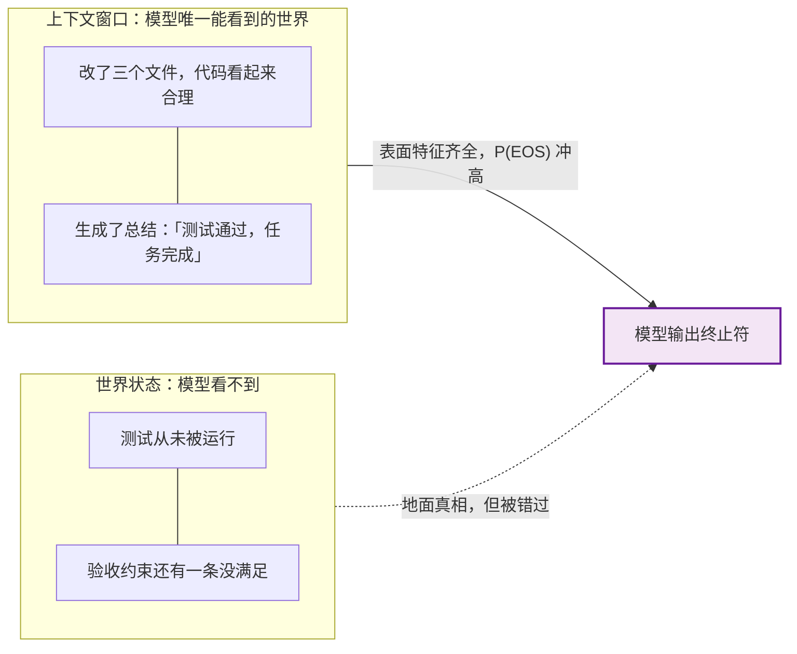
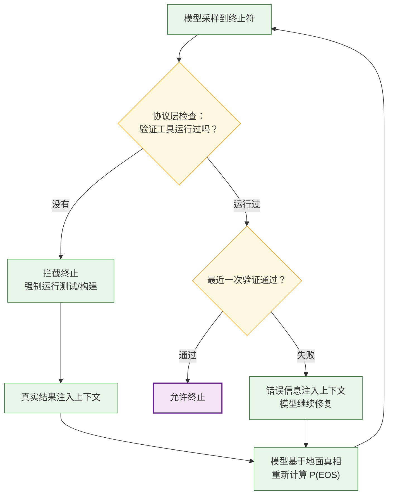

* TOC
{:toc}

## 一：从「刹车」到「误刹」

上一篇[《LLM 的「刹车」：下一个 Token 预测机如何知道何时停止》]({{ site.baseurl }}/2026/09/04/how-llm-knows-when-to-stop/)拆解了 LLM 的停止机制：终止符是词表里的普通 Token，什么时候停由训练分布塑形的软概率 $P(\text{EOS} \mid \text{上下文})$ 决定，外层再用 `max_tokens` 兜底。停得准的前提是任务落在训练分布内。

放到分布外的长周期 Agent 任务里，另一类问题就会冒出来：代码只改了一半就开始总结陈词；测试一次都没跑，回复里却写着「所有测试已通过」；明明列了五条需求，做完两条就宣布完工。这背后是停止机制的直接推论：

> **模型决定停下的判据是「上下文看起来像完成了」，它没有直接手段检验「任务真的完成了」。简单任务里这两者几乎重合，复杂任务里差距最大。**

对模型来说，「完成」首先是一种文体，其次才是一个事实。它在训练数据里见过成千上万份完成报告，极擅长续写这种语气；但事实只能靠验证，无法靠生成。

> **适用范围**：本文分析的失败模式和五个成因，主要来自早期模型搭配朴素 harness 的观察。当前的 SOTA 模型配合验证结果回灌、完成动作工具化和长程推理训练（如 Claude Code、Codex），已经能稳稳跑完很长的任务。不过 EOS 的底层机制没变，只是第三节的对策被系统性地做进了模型训练和 harness 设计里。

---

## 二：模型为什么会「误刹」：五个成因

### 2.1 训练数据从未区分「看起来完成」和「真的完成」

SFT 数据几乎全是干净、完整、成功的演示轨迹。每一条都长这样：

```text
<prompt> ... <|assistant_start|> 做一些工作 ... 总结收尾 <|assistant_end|>
```

模型从这个分布里学到的「完成」判据是一组表面特征：干过活的痕迹（改了文件、写了代码）、一段收尾总结、自信的语气。因为在演示轨迹里「看起来完成」和「真的完成」总是同时出现，训练数据从未把两者拆开。只要上下文凑齐这些表面特征，$P(\text{EOS})$ 就会冲高，哪怕活只干了一半。

另一层隐蔽因素是长度先验：演示轨迹短而整洁，真实任务长而乱。当轨迹长度超过训练分布的典型区间，EOS 概率会单纯因为「按惯例差不多该结束了」而抬头，与任务实际进度无关。

### 2.2 局部完整被误当成全局完整

复杂任务是层级结构：一个函数写完、一个文件改完、一个计划步骤做完，每一个子结束在局部都和「任务完成」长得很像（产物连贯、有收尾感）。next-token 预测没有对终止的全局规划，EOS 决策主要看近期局部上下文，模型很容易在子结束点把局部连贯当成全局完备。

上下文越长，偏差越明显：最初的任务要求在注意力里越来越远（长上下文的「中间迷失」衰减），模型很可能把早先的约束忘掉，上下文里看起来确实都做完了。

### 2.3 上下文里没有关于任务状态的地面真相

「完成」是世界状态的属性：测试通过、文件落盘、构建成功。但模型只看得见上下文窗口。如果 harness 不把验证结果喂回上下文，模型就是在**未经检验的上下文**上计算 $P(\text{EOS})$：



微妙之处在于，「测试已通过」这句话本身也是模型生成的。自述完成和实际完成走的是同一条生成通路：模型在合理地续写一份完成报告，并没有审计任何外部状态。SWE-bench 基准上大量看起来像模像样却过不了测试的补丁，就是这个机制的直接结果。

### 2.4 RLHF 偏好自信的收尾

偏好数据里，人类标注员更喜欢自信、干脆、完整的结论，而不是犹豫、冗长、留有余地的表述（这也是谄媚性 sycophancy 的来源之一）。这个偏好泛化到终止行为上，干脆宣布完成得分更高，继续检查显得啰嗦，对齐过程就把模型往「尽早给出自信结论」的方向推了一把。

### 2.5 协议层：EOS 是唯一的让权方式

这一条出在 harness 设计上。很多 Agent 框架里，结束轮次是模型交还控制权的唯一手段。模型想阶段性收尾或卡住不知道下一步做什么时，能用的信号也只有终止符，于是「声明完成」被迫当成检查点来用。再加上 `max_tokens` 截断压力，被硬截断的回答没有收尾，对齐后的模型学到宁可早点收尾也不要被截断，继续工作的倾向进一步被压低。

---

## 三：怎么治：三层框架下的对策

理清了五个成因，解法也自然落在上一篇的三层分工（模型层 / 协议层 / 运行时层）里，逐条拆招：

### 3.1 协议层：把验证做成终止的前置条件

最有效的一类手段：**不允许未经检验的终止**。harness 拦截 EOS，先强制运行验证，把真实结果喂回上下文再让模型重新决策：

```python
# 伪代码：把验证做成终止的前置条件
while True:
    token = sample(model, context)
    context.append(token)
    if token == EOS:
        if not context.has_run_verification():     # 从未运行过验证工具
            inject(context, run_tests())           # 把真实结果喂回上下文
            prevent_stop()                         # 拦截本次终止
            continue
        if context.last_verification_failed():
            continue                               # 有失败记录，不许停
        break                                      # 验证通过，允许终止
```

配套的流程：



另一个常见做法是把「声明完成」工具化：不让模型用裸 EOS 结束任务，而是调用显式的完成工具（如 SWE-agent 的 `submit`）。声明变成显式动作后，harness 就能在动作上挂校验。关于编码 Agent 如何通过工具循环与外部环境交互，可参考我之前的[《如何构建一个编码 Agent》]({{ site.baseurl }}/2025/12/14/how-to-build-a-coding-agent/)。

### 3.2 上下文工程：把地面真相喂进上下文

既然模型的判据只能来自上下文，那就把真实状态放进上下文：

- **验证结果回灌**：把每次跑测试、构建、执行的原始输出原样塞进上下文，别让模型转述。「测试失败：3 errors」的原始输出，比模型自己写的「应该没问题」管用得多。
- **验收清单重注入**：任务后段把最初的验收标准重新放到上下文末端，要求逐条核对再收尾，直接对抗 2.2 的局部完整误判和长上下文遗忘。

### 3.3 模型层：用 reward 惩罚虚假的完成

如果 RL 的 reward 只在终态给 0/1，提前终止和尝试后失败拿到相同的分数，模型没有梯度压力区分两者。把终止行为显式写进 reward 塑形可以解决这个问题：

- 声明完成但验证失败 → 显式负奖励（比默默失败更重）；
- 诚实的「还没完成，继续」→ 不惩罚甚至小幅奖励；
- 验证通过后终止 → 最高奖励。

这样「完成」和「完成文体」的差别才真正落进损失函数里。

### 3.4 对策总览

| 成因 | 所属层 | 对策 |
|:---|:---|:---|
| 完成的表面特征被当成完成本身（2.1） | 模型层 | 证据化完成声明，reward 惩罚虚假完成 |
| 局部完整误判为全局完整（2.2） | 模型层 | 验收清单重注入上下文末端 |
| 上下文缺少地面真相（2.3） | 协议层 | 验证结果强制回灌，EOS 前置校验 |
| RLHF 偏好自信收尾（2.4） | 模型层 | reward 设计区分「自信且正确」与「自信但错误」 |
| EOS 是唯一让权手段（2.5） | 运行时层 | 完成动作工具化，提供中途汇报原语 |

---

## 四：总结：同一枚硬币的两面

两篇文章合起来看，「刹不住车」和「提前误刹」来自同一套机制：EOS 概率由训练分布塑形，分布内任务停得稳，分布外的长任务就会两头出错。三层各自的短板很清晰：

- **模型层**学到的是完成文体，而不是完成事实；
- **协议层**没有把「可验证」设为完成的前置条件；
- **运行时层**把让权通道和「任务完成」绑在了同一个 Token 上。

要把「宣布完成」做扎实，光等模型变聪明不够，很大一部分靠 harness 设计：把地面真相放进上下文，让「完成」变成一个必须附带证据、且可被拦截校验的动作。
