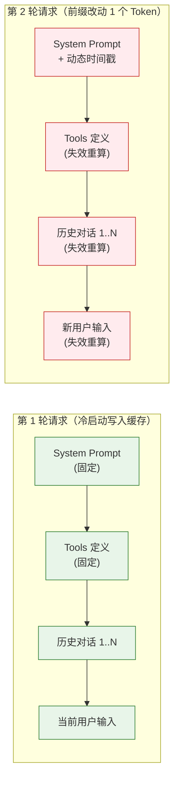
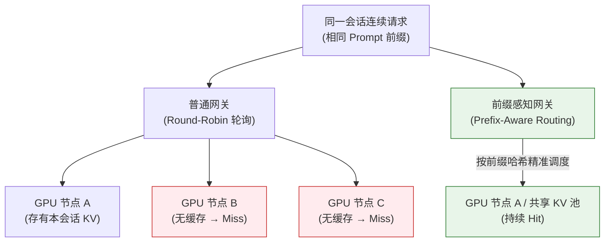

* TOC
{:toc}

在长上下文 Agent、多轮代码编辑和企业知识库问答中，**Prompt Caching（前缀缓存 / KV Cache 复用）** 已经从「锦上添花的优化」变成了决定推理成本与首字延迟（TTFT）的核心变量。

实际工程里经常会遇到三个很具体的问题：
1. 缓存命中率到底怎么算？各家 API 返回字段不一致时怎么对齐？
2. 同一套 Prompt，为什么切到有的厂商命中率高达 95%+，切到另一家直接跌到 20% 甚至 0%？
3. 命中率从 95% 卷到 99%，表面上只涨了 4 个百分点，在真实 API 账单上到底能省出多少可用额度？

本文从公式、底层推理架构，到四家最新主力模型的真实 API 定价，把这笔账一次算清。

---

## 一：缓存命中率的计算公式

LLM 服务的缓存命中率最核心的是 **Token 级命中率**（直接决定计费折扣和 Prefill 算力节省），其次是 **请求级命中率**。

### 1.1 Token 级缓存命中率（核心指标）

$$
\text{Token 缓存命中率} = \frac{\text{Cached Input Tokens（命中缓存的输入 Token 数）}}{\text{Total Input Tokens（总输入 Token 数）}} \times 100\%
$$

不同厂商在 API 响应 `usage` 中的字段口径略有差异，统计时需要先对齐分母：

- **OpenAI / DeepSeek / Gemini**：总输入字段（如 `prompt_tokens`、`promptTokenCount`）**已经包含**缓存命中的部分，直接相除即可：
  - OpenAI：`prompt_tokens_details.cached_tokens / prompt_tokens`
  - DeepSeek：`prompt_cache_hit_tokens / (prompt_cache_hit_tokens + prompt_cache_miss_tokens)`
  - Gemini：`usageMetadata.cachedContentTokenCount / usageMetadata.promptTokenCount`
- **Anthropic (Claude)**：输入被拆成三个互斥字段——未命中且未写缓存的 `input_tokens`、触发写入缓存的 `cache_creation_input_tokens`、命中读取的 `cache_read_input_tokens`，总输入为三者之和：

$$
\text{Claude 命中率} = \frac{\text{cache\_read\_input\_tokens}}{\text{input\_tokens} + \text{cache\_creation\_input\_tokens} + \text{cache\_read\_input\_tokens}}
$$

### 1.2 请求级命中率（辅助监控）

$$
\text{请求命中率} = \frac{\text{至少命中部分缓存的请求数}}{\text{总请求数}} \times 100\%
$$

这一指标常用于语义缓存（Semantic Cache）或粗粒度 SLA 监控；但在前缀缓存场景下，一条 50K Token 的请求只命中了开头 1K 也会被算作「请求命中」，因此**衡量成本收益必须看 Token 级命中率**。

### 1.3 本质约束：严格前缀匹配（Prefix Matching）

Transformer 自回归推理的注意力计算满足因果掩码（Causal Mask）：第 $i$ 个 Token 的 Key/Value 向量只依赖它自己和前面 $1 \sim i-1$ 个 Token。这决定了 KV Cache 复用的铁律——**严格前缀匹配**：

只要前缀里有一个字符变了（哪怕是 System Prompt 开头塞了一个 `Current time: 12:04:01`），从变动位置往后的所有 Token 都会触发全量 Prefill 重算，命中率瞬间归零。

---

## 二：缓存命中率跟哪些因素有关？

命中率由**应用侧的 Prompt 组织方式**和**服务端的推理基础设施**共同决定。

### 2.1 应用侧因素

- **前缀稳定性（第一决定因素）**：System Prompt、Tools/Function Schema、静态背景文档是否严格固定在最前面；每次构造请求时，工具列表顺序或 JSON 序列化后的 key 顺序是否完全确定。
- **业务形态与轮次**：多轮 Coding Agent、长文档连续追问天然拥有极高的前缀重叠度（常见 80%～99%）；单轮随机问答、短文本批处理命中率天然偏低。
- **请求间隔与 TTL**：同前缀的相邻两次请求间隔是否短于服务端的缓存存活时间（TTL）。
- **最小长度门槛与分块对齐（Block Size）**：推理引擎通常按固定块（如 64 / 128 tokens）做哈希索引，且设有最小触发阈值（如 512 / 1024 / 4096 tokens），低于门槛不走缓存。

### 2.2 服务端侧因素

- **路由策略**：同一会话的多轮请求是否能落到持有对应 KV Cache 的节点上。
- **存储介质与容量**：KV Cache 仅驻留 GPU 显存（HBM），还是支持异步卸载到主机内存（DRAM）乃至分布式 NVMe SSD。
- **并发与驱逐压力**：高峰期显存紧张会加速 LRU/LFU 淘汰（Eviction），缩短缓存实际存活时间。
- **触发机制**：默认开启的隐式自动缓存（Implicit Caching），还是需要调用方手动打断点的显式缓存（Explicit Caching）。

---

## 三：为何有的模型厂商命中率很高，有的很低？

同一套 Agent 代码，不改一行 Prompt，切到不同供应商时命中率可能从 90%+ 暴跌到 20% 甚至 0%。背后的分水岭主要是五个工程架构差异：

### 3.1 存储分层架构：单机 HBM vs 分布式内存/硬盘池

- **高命中率厂商**：不把 KV Cache 局限在昂贵且狭小的 GPU 显存里，而是构建 **HBM → 主机 DRAM → 分布式 NVMe SSD** 的多级分层缓存（如 DeepSeek 公开的硬盘级上下文缓存、头部大厂基于 RDMA 的分布式 KV 池）。缓存容量扩大几个数量级，哪怕隔了几十分钟再来依然命中。
- **低命中率厂商**：仅依赖推理框架（如默认配置的 vLLM / SGLang）的单机 GPU 显存 RadixAttention。高峰期并发一上来，显存几秒钟就被新请求冲刷一遍，旧缓存还没等到下一轮就被淘汰。

### 3.2 集群调度路由：轮询负载均衡 vs 前缀感知路由

- **高命中率厂商**：网关层实现了 **Prefix-Aware / Cache-Aware Routing**（或 PD 分离 + 共享 KV 存储池），根据前缀哈希把请求精准路由到存有该 KV Cache 的节点。
- **低命中率厂商**：采用普通轮询或最小连接数负载均衡。100 张卡的集群里，连续 10 轮对话每次被打到不同实例，命中率理论上趋近于 0%。

### 3.3 模型架构本身的 KV Cache 体积

采用 **MLA（Multi-head Latent Attention）**、极低 KV Head 的 **GQA** 或 **线性/全注意力混合架构** 的模型，单 Token 的 KV Cache 占用比传统 MHA 小一个数量级。在同等显存与内存预算下，能同时驻留的上下文数量多出数倍，淘汰率大幅下降。

### 3.4 隐式自动缓存 vs 显式断点缓存

- **隐式自动缓存**（如 DeepSeek、Gemini 隐式缓存）：服务端自动按前缀块匹配，开发者零改造即可拿到高命中率。
- **显式断点缓存**（如 Anthropic Claude 的 `cache_control`）：需要客户端在请求体中明确标记缓存断点。如果使用的 SDK、代理层或 Agent 框架没有做对应适配，命中率就是 0%。

### 3.5 多云与聚合网关的集群碎片化

部分 API 聚合平台或中转商会在后台将流量动态分发到多个底层云厂商（如不同区域的 Bedrock、Vertex、自有集群）之间。请求一旦跨集群漂移，前缀缓存完全无法复用。

---

## 四：算一笔账：\$100 预算下，99% 比 95% 多出多少可用额度？

很多人直觉上觉得：命中率 95% 已经很高了，再花精力优化到 99%，多出来的 4% 值得折腾吗？

**非常值得。在当前主流的 0.2 折～0.5 折缓存定价下，最后 4% 存在巨大的「账单杠杆」。**

### 4.1 通用推导

设标准输入单价为 $P_{\text{in}}$，未命中时若触发缓存写入的写入单价为 $P_{\text{write}}$（无写入溢价的厂商则 $P_{\text{write}} = P_{\text{in}}$），缓存命中读取单价为 $P_{\text{hit}}$。当命中率为 $h$ 时，平均每 Token 的有效输入成本为：

$$
C_{\text{in}}(h) = (1 - h) \cdot P_{\text{write}} + h \cdot P_{\text{hit}}
$$

同样花 \$100，命中率从 $h_1 = 95\%$ 提升到 $h_2 = 99\%$ 时，纯输入可用 Token 量的提升比例为：

$$
\text{纯输入提升比例} = \frac{C_{\text{in}}(0.95)}{C_{\text{in}}(0.99)} - 1
$$

之所以杠杆惊人，是因为当缓存命中便宜 20～50 倍时，**那 5% 未命中的 Token 往往吃掉了超过一半的输入账单**。把未命中率从 5% 压到 1%，等于直接把最贵的那部分开销砍掉了 80%。

### 4.2 四家最新主力模型真实 API 定价实算

以下基于 2026 年 11 月各家官方标准 API 定价（单位：美元 / 1M Tokens），对比四款最新主力模型在 **\$100 预算**下的表现：

- **DeepSeek-V4.1-Flash**（高峰时段；低谷半价，提升比例完全一致）
- **Claude Opus 5.5**（默认 5 分钟 TTL，写入 1.25×）
- **OpenAI GPT-6.2 Sol**（默认 30 分钟 TTL，写入 1.25×）
- **Gemini 4 Neon**（隐式自动缓存，无写入溢价）

#### 表 1：纯输入与真实场景（输入 : 输出 = 50 : 1）提升对比

| 模型 | 官方单价（\$/1M） 输入 / 写入 / 命中 / 输出 | 缓存折扣 | 纯输入：\$100 购买量 （95% → 99%） | 纯输入 提升幅度 | 真实场景（50:1） \$100 等效变为 |
| :--- | :---: | :---: | :---: | :---: | :---: |
| **DeepSeek-V4.1-Flash** | \$0.30 / 无 / **\$0.006** / \$1.20 | **0.2 折** （省 98%） | 4,831M → **11,186M** | **+131.5%** | **+35.7%** （等效 **\$135.7**） |
| **Claude Opus 5.5** | \$4.00 / **\$5.00** / **\$0.20** / \$20.00 | **0.5 折** （省 95%） | 227.3M → **403.2M** | **+77.4%** | **+29.6%** （等效 **\$129.6**） |
| **OpenAI GPT-6.2 Sol** | \$2.00 / **\$2.50** / **\$0.10** / \$10.00 | **0.5 折** （省 95%） | 454.5M → **806.5M** | **+77.4%** | **+29.6%** （等效 **\$129.6**） |
| **Gemini 4 Neon** | \$3.00 / 无 / **\$0.15** / \$15.00 | **0.5 折** （省 95%） | 341.9M → **560.2M** | **+63.9%** | **+23.8%** （等效 **\$123.8**） |

#### 表 2：真实 Coding Agent 场景（50:1）下，\$100 实际总吞吐量

真实调用中，**Output Token 无法享受缓存折扣，且单价是输入的 4～5 倍**（对于推理模型还包含 Thinking Tokens），会稀释一部分输入缓存红利。以典型多轮代码编辑（每输入 50M Tokens 产生 1M Output Tokens）为例：

| 模型 | 95% 命中率（\$100 可买） | 99% 命中率（\$100 可买） | 多出来的等效额度 |
| :--- | :---: | :---: | :---: |
| **DeepSeek-V4.1-Flash**（高峰） | 2,237M 输入 + 44.7M 输出 | **3,036M 输入 + 60.7M 输出** | **+\$35.7** |
| **OpenAI GPT-6.2 Sol** | 238.1M 输入 + 4.76M 输出 | **308.6M 输入 + 6.17M 输出** | **+\$29.6** |
| **Gemini 4 Neon** | 168.8M 输入 + 3.38M 输出 | **209.0M 输入 + 4.18M 输出** | **+\$23.8** |
| **Claude Opus 5.5** | 119.0M 输入 + 2.38M 输出 | **154.3M 输入 + 3.09M 输出** | **+\$29.6** |

### 4.3 三个反直觉的账单结论

1. **Claude Opus 5.5 与 GPT-6.2 Sol 的定价结构完全同构**：两者都是 `输入 : 写入 : 命中 : 输出 = 1 : 1.25 : 0.05 : 5`（GPT-6.2 Sol 绝对单价正好是 Opus 5.5 的一半），因此 95% → 99% 的提升比例完全一致——**纯输入 +77.4%，综合 +29.6%**。如果业务选用了长 TTL 缓存写入（Claude 1 小时 2.0×、OpenAI 12 小时 2.5×），断缓存的惩罚更重，99% 命中率的相对收益还会进一步放大。
2. **Gemini 4 Neon 因为无写入溢价，断缓存容错率更高**：同样是 0.5 折缓存和 5 倍输出单价，但因为采用隐式自动缓存、不收 1.25× 写入费，未命中时的代价更温和，95% → 99% 的综合提升为 **+23.8%**。
3. **DeepSeek-V4.1-Flash 的缓存杠杆最高**：命中单价低至未命中的 **1/50（0.2 折）**，且输出/输入比价只有 4:1，把命中率从 95% 推到 99% 后，\$100 在纯输入上能多买 **131.5%** 的量，算上输出依然能多出 **\$35.7** 的等效额度。

---

## 五：工程实践——如何把业务命中率推向 99%？

理解了前缀匹配和计费杠杆后，应用侧的优化方向非常明确：

1. **严格分离静态前缀与动态后缀**：System Prompt、角色设定、工具定义、项目级规范永远放在最前面且保持逐字节不变；当前时间、用户状态、动态检索结果统一追加到最新的 User Message 末尾，绝不回写修改 System Prompt。
2. **保证序列化确定性**：动态构造的 Tools 列表、MCP 工具注册表、JSON Schema 必须按固定规则排序（如按名称字典序），避免不同进程/轮次间因为字典迭代顺序变化导致缓存集体失效。
3. **慎用「每轮改写历史」的上下文管理**：不要在每轮对话里实时摘要或删减中间历史消息——每改一次历史，后面几十 K 的缓存全部报废。更合理的做法是**追加式增长（Append-only）**，只在逼近上下文上限时做一次性的批量 Compaction，把缓存失效次数压到最低。
4. **显式缓存模型正确放置断点与选择 TTL**：调用 Claude 或支持长 TTL 的模型时，将缓存断点放在静态前缀末尾与最新一轮历史消息处；如果 Agent 思考/等待人工确认的间隔经常超过 5 分钟，评估切换长 TTL 是否比反复断缓存重写更划算。
5. **在可观测性里直接监控 Token 级命中率**：把每次请求的 `cached_tokens / total_input_tokens` 接入监控看板。一旦某次发版后命中率从 98% 突然掉到 40%，几乎可以立刻定位到是有人不小心往前缀里塞了动态字段或打乱了工具定义顺序。
