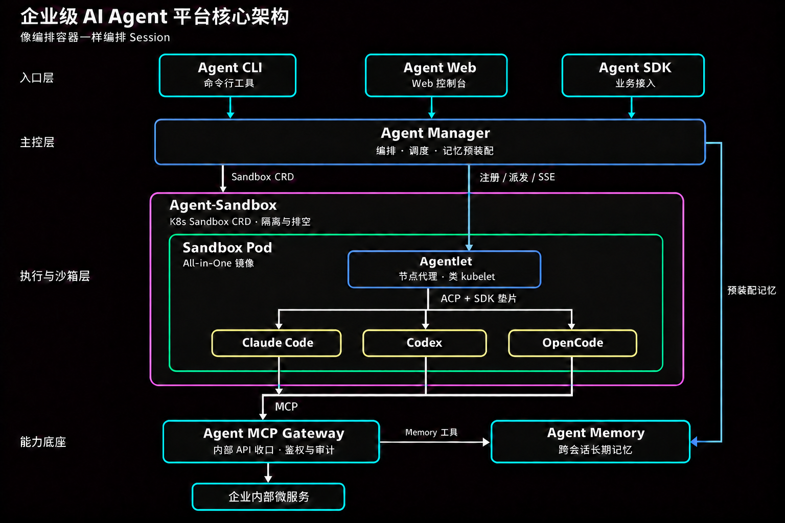
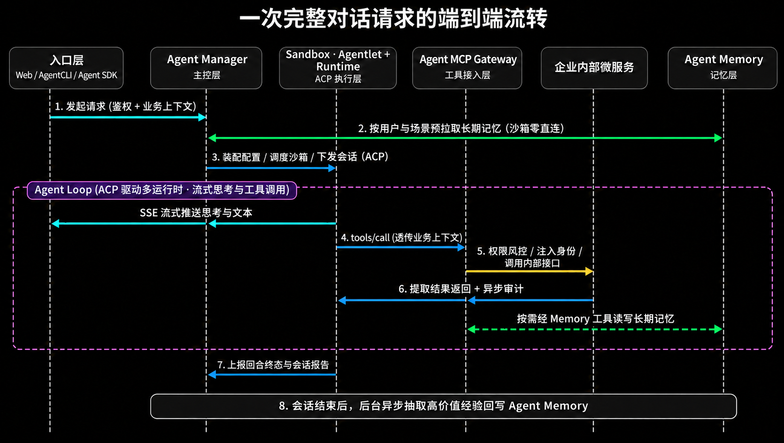

* TOC
{:toc}

写一个单机 Coding Agent，核心循环几百行代码就能跑起来。但拿到公司里给多人用，麻烦的就不是循环本身了：几十上百个会话并发怎么调度、执行环境怎么隔离、内部业务接口怎么安全接入、历史经验怎么跨会话留下来。

我主导设计并开发的这套企业级 Agent 平台的做法，是把 Session 当作最小调度单元，整体分层基本照着 Kubernetes 编排容器的思路来：入口层接请求，控制面做装配和调度，沙箱层提供隔离节点，节点代理抽象不同的 Agent Runtime。容器跑完进程就结束了，Session 还要调公司内部接口、还要记东西，所以在这套编排之外又独立了工具网关和记忆服务。

## 一、整体分层

各层之间只走网络协议或 Kubernetes CRD，不共享数据库。对照 Kubernetes 的组件，分工大概是这样：

| 层级 | 组件 | K8s 类比 | 职责 |
| --- | --- | --- | --- |
| 入口层 | `Agent Web` / `Agent CLI` / `Agent SDK` | Dashboard / `kubectl` / Client SDK | 接网页、终端和业务系统三类请求，统一进控制面 |
| 主控层 | `Agent Manager` | Control Plane (API Server / Scheduler / Reconciler) | 管资产、权限、会话装配、记忆预拉取和沙箱调度 |
| 沙箱层 | `Agent Sandbox` | Node / 算力节点 | 基于开源 `kubernetes-sigs/agent-sandbox`，用 CRD 管运行时 Pod 的身份、存储和隔离 |
| 运行时层 | `Agentlet` + Runtimes + 统一镜像 | `kubelet` + CRI + `containerd` + 容器镜像 | 跑在沙箱内的节点代理，靠 All-in-One 镜像和 ACP 协议纳管 `Claude Code`、`Codex` 和 `OpenCode` |
| 工具网关 | `Agent MCP Gateway` | Agent 专属扩展 | 把公司内部微服务 API 转成标准 MCP Tool，做鉴权、风控和审计 |
| 记忆服务 | `Agent Memory` | Agent 专属扩展 | 为会话提供跨生命周期的长期记忆注入、按需读写与异步抽取 |

## 二、入口层：Agent Web、Agent CLI 与 Agent SDK

`Agent Web` 给人用，负责 Agent 编排、Skill / MCP 资产管理、对话和审批，权限判断统一在后端完成。

`Agent CLI` 是 `Agent Web` 的命令行化形态，采用 `kubectl` 风格，方便用户通过本地的 Agent 或终端直接操作和管理平台。

`Agent SDK` 给内部业务系统接入，封装对话、流式输出和会话状态查询，并支持把终端用户的业务身份安全透传给下游工具。

## 三、主控层：Agent Manager

`Agent Manager` 管着平台所有的元数据和状态：Agent 定义与版本、Skill 目录、模型配置、Agent Runtime / Harness 配置、多租户权限、引擎池以及会话生命周期。

它自己不跑模型循环，也不执行工具。控制面发版不会中断运行中的长会话，单个沙箱节点故障也不会影响管理后台。

一次对话请求进来，控制面先拼出这次会话需要的 Agent 定义、Runtime / Harness 配置、Skills、模型配置和授权 MCP 清单，再去记忆服务按场景拉取相关记忆，全部备齐后派发给空闲沙箱。

## 四、沙箱层：Agent Sandbox

Kubernetes 原生的 `Deployment` 面向无状态副本，缺少单实例稳定身份和独立持久工作目录；`StatefulSet` 按序号伸缩，很难单独回收中间某个空闲或解绑的专属实例。

平台引入了 Kubernetes SIG Apps 孵化的开源项目 [`kubernetes-sigs/agent-sandbox`](https://github.com/kubernetes-sigs/agent-sandbox)（下文简称 `Agent Sandbox`）。`Agent Manager` 通过 `Sandbox` CRD 管理集群里的运行时节点，提供稳定的网络身份和持久化工作目录，同时支持共享引擎池和按 Agent 独占绑定两种模式。节点缩容或回收前先排空，不再派发新会话，等在途任务结束后再删 `Sandbox`。

在此之上，`Agent Sandbox` 还提供 `SandboxTemplate`、`SandboxWarmPool`、`SandboxClaim`（预热池认领）以及通过 Kubernetes `RuntimeClass` 对接 gVisor / Kata Containers 的强隔离能力。

## 五、运行时层：Agentlet、ACP 与统一镜像

`Agent Sandbox` 负责把 Pod 拉起来，跑在 Pod 里跟控制面打交道的是 `Agentlet`。和 Kubernetes 里 `kubelet` 通过 CRI 隔离容器运行时一样，`Agentlet` 以 ACP（Agent Client Protocol）为核心抽象，把控制面调度和底层各种 Agent Runtime 隔开。

### 5.1 ACP + SDK 垫片收敛多类 Runtime

Sandbox Pod 起来后，`Agentlet` 主动向 `Agent Manager` 反向注册，上报可用 Runtime 和负载心跳。往下所有执行引擎都收敛在 ACP 这一套统一交互抽象里：

- `OpenCode` 等原生支持 ACP 的代理，直接通过标准 ACP 协议接入。
- `Claude Code` 和 `Codex` 官方 CLI 原生不支持 ACP，通过 `Agentlet` 内置的 SDK 垫片做协议转换后接入。

上层控制面和业务方只面对 `Agentlet` 这一层，切换底层 Runtime 只需要改配置。

### 5.2 All-in-One 镜像与滚动更新

沙箱容器采用 All-in-One 统一镜像：底包预装常用的脚本与数据分析环境，上层打包 `Agentlet` 以及 `Claude Code`、`Codex` 和 `OpenCode` 三个运行时。

同一套引擎池可以按会话配置动态选 Runtime，不用为每种引擎各维护一套镜像和算力池。镜像版本和引擎池模板由 `Agent Manager` 统一管理，升级时配合节点排空机制逐批滚动替换 Sandbox。

## 六、工具网关：Agent MCP Gateway

公司内部业务接口多、鉴权方式不统一，`Agent MCP Gateway` 把这些微服务 API 统一转成标准 MCP Tool 对外暴露。

网关提供单一接入端点，按场景标签和权限动态裁剪工具列表，避免一次把全量接口 Schema 灌进上下文。工具元数据支持热刷新，下游接口的认证、参数映射和响应提取全部可配置化。

同时，网关内置细粒度权限校验、风险分级、高危操作人工确认和全链路审计，并负责在调用下游微服务前还原业务身份上下文，保证沙箱和执行引擎不接触明文凭据。

## 七、记忆服务：Agent Memory

`Agent Memory` 负责跨会话的长期记忆，让 Agent 在不同会话之间保留背景知识与历史经验。在平台里，它按会话阶段分三段介入，沙箱内不直连记忆服务：

- 会话前：`Agent Manager` 按当前用户和场景预拉取相关记忆，随会话上下文一并下发。
- 运行中：需要主动查或写记忆时，统一调用 `Agent MCP Gateway` 暴露的 Memory 工具，沙箱本身不持有记忆服务密钥。
- 会话后：后台任务从结束的会话记录里异步抽取有价值的经验回写记忆库，敏感维度过隐私校验和人工审批。

## 八、一次完整请求的流转

整个流程里，配置装配、记忆预拉取和沙箱调度留在控制面，推理和本地工具执行关在沙箱里，访问内部业务接口和长期记忆全部从 `Agent MCP Gateway` 出去。
